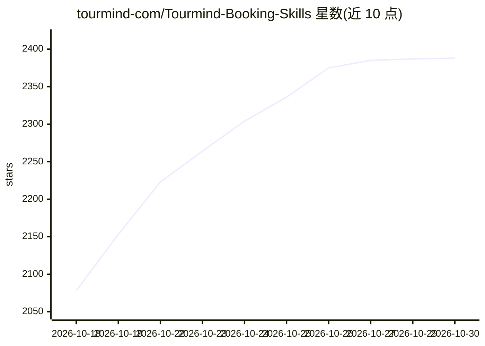

# tourmind-com/Tourmind-Booking-Skills

⭐ 2,388 · Python · MIT · 推送 2026-10-19 · [GitHub](https://github.com/tourmind-com/Tourmind-Booking-Skills) · [官网](https://tourmind.com/skills) · 组织维护 · 中文 README

**让 AI Agent 完成酒店与机票搜索、比价、预订与支付的技能包**

TourMind 维护的 Agent Skills 仓库：为支持 Skills 的 Agent 客户端（ChatGPT Codex、Claude Code、Cursor、Kimi、豆包等）提供端到端酒店与机票预订能力，通过 TourMind API 搜索全球酒店与实时机票、对比 OTA 与供应商的实时价格、核验最终价格，并在用户明确确认后完成预订、支付、订单查询与酒店取消。搜索无需 Token，验证、预订与支付需 TourMind Skill Token；机票技能不支持退改签与辅助服务购买。通过 npx skills add 或让 Agent 自行安装。

## 筛选速览

| 维度 | 判定 | 备注 |
|---|---|---|
| AI 角色 | `ai-ecosystem` | LLM/agent 周边工具 |
| 许可风险 | `permissive` | MIT |
| 部署形态 | `library` | 以包/库形式分发 |
| 模型依赖 | — | README 未给出锁定关系 |
| 硬件要求 | — | 无带数字的原话,不猜 |
| 安装摩擦 | `low` | 无编译、无系统依赖或容器化 |
| 成熟度 | — | 结构信号不足 |

## 能力要点

- 酒店与机票搜索、实时比价、价格核验一体化 Skills
- 预订、支付、取消前需用户在会话中明确确认
- 搜索无需 Token，交易类操作经 Skill Token 认证
- 支付支持 Stripe（加收 3.5% 手续费）及 CNY 订单的微信/支付宝/网银

## 适用场景

- 让 AI Agent 按预算和偏好搜索并对比酒店与机票
- 确认前核验实时房价/票价，再由 Agent 完成预订与支付
- 行程规划时同时搜索机票与酒店并查询订单状态

## 场景标签

 · 领域:旅行/预订服务

## 证据(README 行号)

> L23: Give your AI Agent end-to-end hotel booking and worldwide flight search and booking capabilities. Without leaving y
> L57: TourMind Booking Skills can be used with ChatGPT (Work or Codex mode), Claude Code, WorkBuddy, QClaw, Marvis, OpenC

## 星数曲线

2026-10-18 2,078 → 2026-10-30 2,388（+310）

---
*卡片 v1 · prompt 1.4 · 生成 2026-10-21 · 置信度 high · 依据 README sha `9164f2763944` · [字段定义](../../DATASET.md)*
