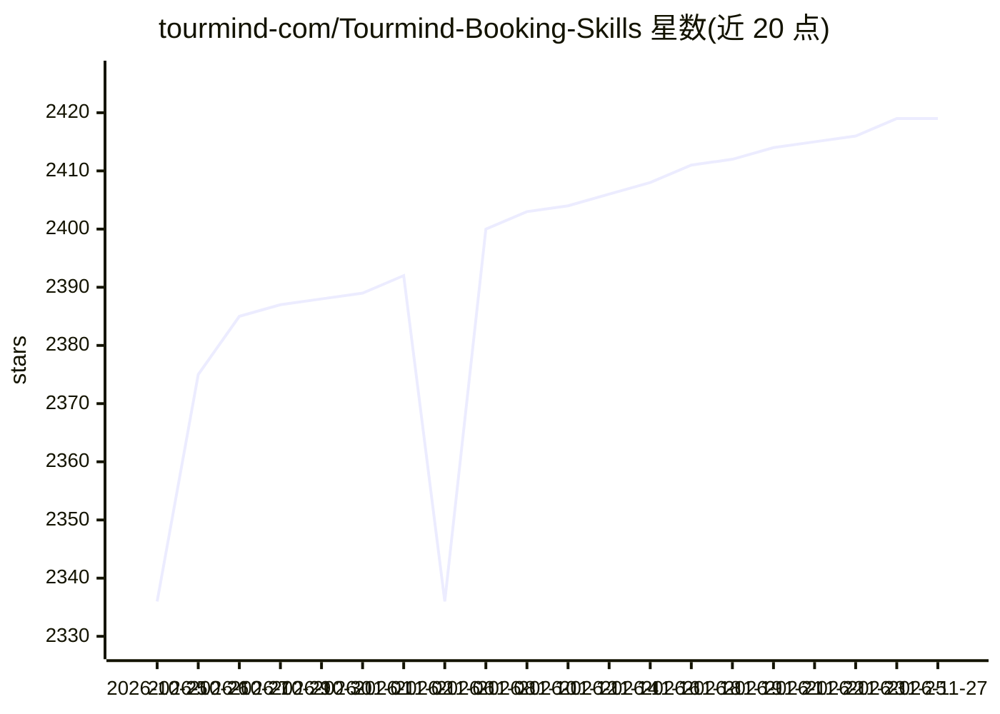

# tourmind-com/Tourmind-Booking-Skills

⭐ 2,419 · Python · MIT · 推送 2026-11-20 · [GitHub](https://github.com/tourmind-com/Tourmind-Booking-Skills) · [官网](https://tourmind.com/skills) · 组织维护 · 中文 README

**让 AI agent 搜索比价并预订全球酒店与机票的技能包**

TourMind 提供的 agent 技能仓库，包含酒店（tourmind-booking）与机票（flight-booking-ai）两个 Skill：在全球库存中搜索酒店与航班、跨 OTA 与供应商比对实时价格、复核可用性与最终价格，并完成预订、支付、订单查询与符合条件的酒店取消。通过 npx 安装到检测到的 agent 客户端，搜索与比价免 Token，预订/支付/取消需 TourMind Skill Token 且每步需用户明确确认。

## 筛选速览

| 维度 | 判定 | 备注 |
|---|---|---|
| AI 角色 | `ai-ecosystem` | LLM/agent 周边工具 |
| 许可风险 | `permissive` | MIT |
| 部署形态 | `library` | 以包/库形式分发 |
| 模型依赖 | — | README 未给出锁定关系 |
| 硬件要求 | — | 无带数字的原话,不猜 |
| 安装摩擦 | `low` | 无编译、无系统依赖或容器化 |
| 成熟度 | — | 结构信号不足 |

## 能力要点

- 酒店与机票两个 Skill，一次 npx 命令安装到多个 agent 客户端
- 搜索与比价免 Token；预订、支付、取消需 Token 与显式确认
- 交易前展示关键细节并等待确认，搜索不产生订单
- 同一 Skill Token 覆盖两个 Skill，本地文件权限 chmod 600 保护

## 适用场景

- 在 agent 对话中搜索并比对东京酒店实时房价后预订
- 查找上海往返东京航班并核对行李额与总价
- 让 agent 规划含机票与酒店的整体行程
- 查询已下单机票/酒店的订单状态与支付方式

## 场景标签

 · 领域:旅行/预订服务

## 证据(README 行号)

> L23: Give your AI Agent end-to-end hotel booking and worldwide flight search and booking capabilities. Without leaving y
> L57: TourMind Booking Skills can be used with ChatGPT (Work or Codex mode), Claude Code, WorkBuddy, QClaw, Marvis, OpenC
> L61: This Skill repository combines hotel and flight support for both personal (ToC) and business (ToB) users. MCP packa

## 星数曲线

2026-10-25 2,336 → 2026-11-27 2,419（+83）

---
*卡片 v1 · prompt 1.4 · 生成 2026-11-23 · 置信度 high · 依据 README sha `365681741ecc` · [字段定义](../../DATASET.md)*
