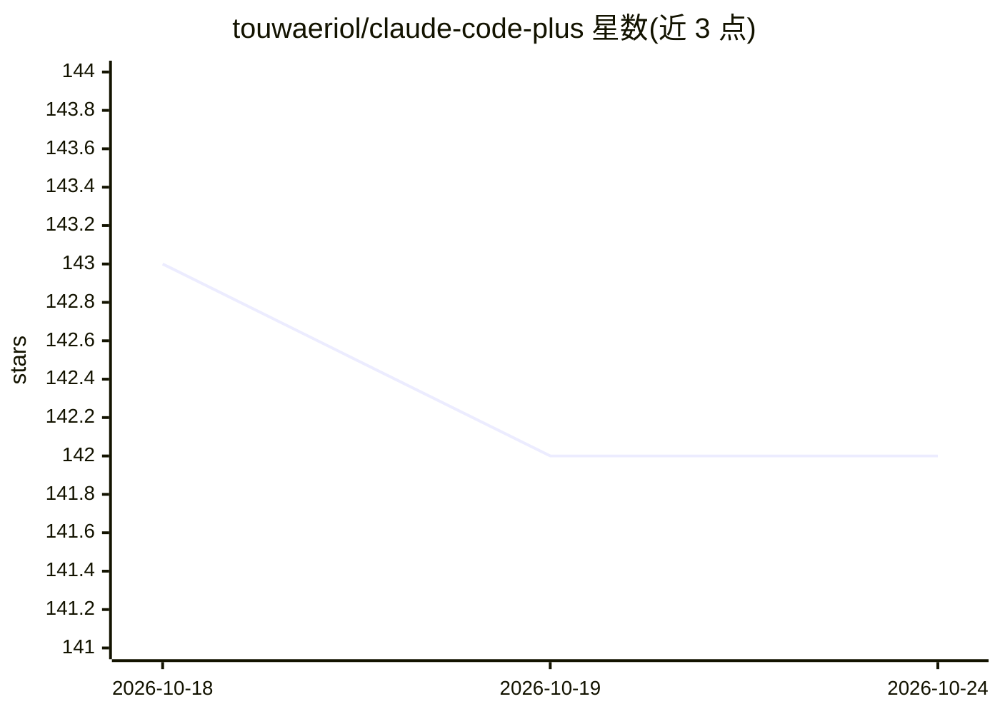

# touwaeriol/claude-code-plus

⭐ 142 · JavaScript · MIT · 推送 2026-04-15 · [GitHub](https://github.com/touwaeriol/claude-code-plus) · [官网](https://plugins.jetbrains.com/plugin/28343-claude-code-plus) · 个人维护 · 中文 README

**JetBrains IDE 中运行 Claude Code 的 GUI 插件**

IntelliJ IDEA 插件，将 Claude Code CLI 以图形界面嵌入 IDE：提供聊天窗口、@ 引用文件作为上下文、多会话管理、查看 Claude 工具调用（文件读写、bash 等）并点击跳转文件与 diff 预览，支持模型切换（Opus/Sonnet/Haiku 4.5）、MCP 配置与权限确认对话框。要求 JetBrains IDE 2024.2-2025.3.x 与 Node.js v18+，插件捆绑 Claude CLI，也可通过 cc-switch 改用自有 Anthropic API key。经 JetBrains Marketplace 或手动安装 zip 包。

## 筛选速览

| 维度 | 判定 | 备注 |
|---|---|---|
| AI 角色 | `ai-ecosystem` | LLM/agent 周边工具 |
| 许可风险 | `permissive` | MIT |
| 部署形态 | `desktop` | 安装包/桌面程序 |
| 模型依赖 | locked-api |  |
| 硬件要求 | — | 无带数字的原话,不猜 |
| 安装摩擦 | `low` | 无编译、无系统依赖或容器化 |
| 成熟度 | — | 结构信号不足 |

## 能力要点

- 在 IDE 内以 GUI 会话运行 Claude Code，@ 引用文件作为上下文
- 查看 Claude 工具调用详情并可点击打开文件、预览 diff
- 支持 MCP 配置、模型切换（Opus/Sonnet/Haiku 4.5）与权限确认对话框
- 捆绑 Claude CLI，或经 cc-switch 改用 Anthropic API key 认证

## 适用场景

- 不想离开 IDE、用图形界面操作 Claude Code 完成编码任务
- 在多个聊天会话间管理不同任务的 AI 对话
- 导出 AI 对话记录用于回顾或分享

## 场景标签

`编码 Agent` · 领域:编码与开发

## 证据(README 行号)

> L16: Claude Code Plus is an IntelliJ IDEA plugin that integrates Claude AI directly into your development environment, p
> L88:  - Open terminal and run: `npx @anthropic-ai/claude-code`

## 星数曲线

2026-10-18 143 → 2026-10-24 142（-1）

---
*卡片 v1 · prompt 1.4 · 生成 2026-10-23 · 置信度 mid · 依据 README sha `d1cf33d6c49a` · [字段定义](../../DATASET.md)*
