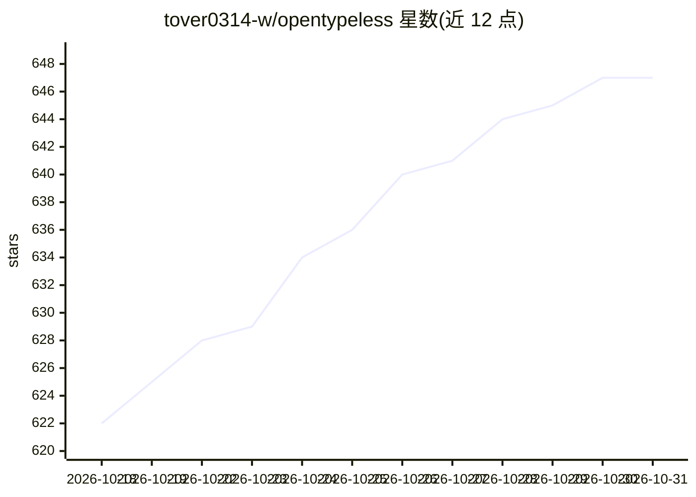

# tover0314-w/opentypeless

⭐ 647 · Rust · MIT · 推送 2026-10-22 · [GitHub](https://github.com/tover0314-w/opentypeless) · [官网](https://www.opentypeless.com) · 个人维护 · 中文 README

**跨平台 AI 语音输入工具：热键说话即得润色文本**

基于 Tauri 的桌面应用，面向在 macOS/Windows/Linux 上需要语音打字的用户。提供四种语音工作流：听写（转写并可选 LLM 润色）、一次性语音问答 Ask Anything、选中文本改写与翻译。支持多种 STT 提供商（Deepgram、AssemblyAI、Groq Whisper、豆包等）与多种 LLM（OpenAI 兼容、Ollama 等），支持 BYOK 或托管云额度。本地进行应用检测与词典纠正，仅发送应用类别与样式元数据给 LLM。提供安装包下载，Linux Wayland 需 wtype/kwtype 辅助工具。

## 筛选速览

| 维度 | 判定 | 备注 |
|---|---|---|
| AI 角色 | `ai-native` | 本体是模型或模型工具 |
| 许可风险 | `permissive` | MIT |
| 部署形态 | `desktop` | 安装包/桌面程序 |
| 模型依赖 | local-ok | 支持本地模型 |
| 硬件要求 | — | 无带数字的原话,不猜 |
| 安装摩擦 | `low` | 无编译、无系统依赖或容器化 |
| 成熟度 | — | 结构信号不足 |

## 能力要点

- 听写/问答/选中文本改写/翻译四种语音工作流
- 应用感知润色：本地检测应用类别并调整文体
- 多种 STT 与 LLM 提供商可选，支持 BYOK 与自托管
- 本地词典与纠正规则，导入导出可复用

## 适用场景

- 在任何应用里按热键语音输入，自动润色成文
- 口述问题快速获得 AI 回答，无需打开聊天应用
- 选中已有文本用语音指令改写、翻译或摘要
- 用自定义词典控制专有名词与转写纠错

## 场景标签

`语音识别` `AI 助手` · 领域:对话与助手

## 证据(README 行号)

> L7:  Open-source alternative to Wispr Flow and Superwhisper for AI voice input, rewriting, and voice Q&A on macOS, Windo
> L91: |Dictation|Hold a hotkey, speak, transcribe, optionally polish with an LLM, then type or copy the result into the a
> L92: |Ask Anything|Start a one-shot voice question, transcribe it, send it to the LLM, and show only the final answer in

## 星数曲线

2026-10-18 622 → 2026-10-31 647（+25）

---
*卡片 v1 · prompt 1.4 · 生成 2026-10-21 · 置信度 mid · 依据 README sha `f42f60b29be6` · [字段定义](../../DATASET.md)*
