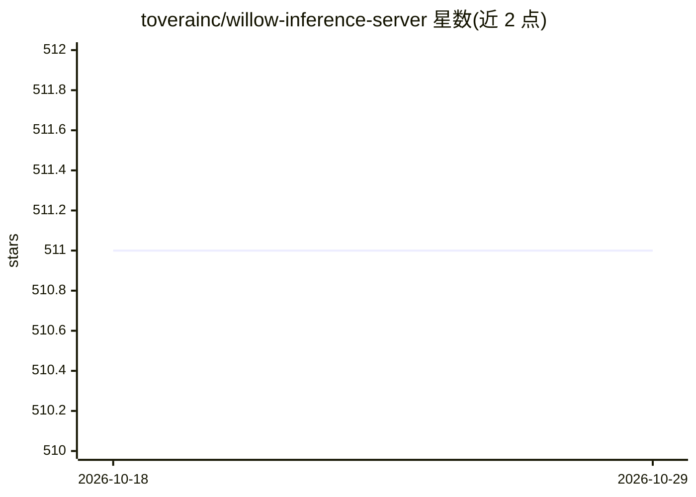

# toverainc/willow-inference-server

⭐ 511 · Python · Apache-2.0 · 推送 2026-02-12 · [GitHub](https://github.com/toverainc/willow-inference-server) · 组织维护

**自托管本地推理服务器：提供 ASR/STT、TTS 与 LLM 推理接口**

面向 CUDA 设备（低端如 GTX 1060/Tesla P4 起，亦可 CPU-only）优化的自托管语言推理服务器，通过 REST、WebRTC、WebSocket 提供语音识别（Whisper base/medium/large-v2 三模型同时加载、CTranslate2 加速）、语音合成（含自定义音色）与 LLM 推理。自动检测 CUDA VRAM 并按序禁用功能，WebRTC 支持长时间会话（空闲时音频轨暂停降至 5kbps）。通过 git clone 加 utils.sh 安装运行；README 自述项目处于早期阶段，1.0 前需自行构建，Docker 容器为未来计划。

## 筛选速览

| 维度 | 判定 | 备注 |
|---|---|---|
| AI 角色 | `ai-ecosystem` | LLM/agent 周边工具 |
| 许可风险 | `permissive` | Apache-2.0 |
| 部署形态 | `None` |  |
| 模型依赖 | — | README 未给出锁定关系 |
| 硬件要求 | `cpu-ok` | |
| 安装摩擦 | `medium` | 含编译或系统依赖之一 |
| 成熟度 | `idea` | |

## 能力要点

- Whisper base/medium/large-v2 三模型与 TTS 共载入 6GB VRAM 内
- 支持 REST/WebRTC/WebSocket 三种传输，WebRTC 空闲音频轨暂停至 5kbps
- 自动检测 CUDA VRAM 并自动优化或按序禁用功能（ASR、TTS）
- 自定义 TTS 音色创建与管理

## 适用场景

- 自托管低延迟实时语音转写服务
- 为 Willow 语音助手等应用提供 ASR/TTS 后端
- 浏览器或 WebRTC 应用中流式实时语音推理

## 场景标签

`语音识别` `语音合成` `推理引擎` · 领域:内容生成

## 证据(README 行号)

> L5: Willow Inference Server (WIS) is a focused and highly optimized language inference server implementation. Our goal i
> L9: - ASR. Heavy emphasis - Whisper optimized for very high quality as-close-to-real-time-as-possible speech recognition

## 星数曲线

2026-10-18 511 → 2026-10-29 511（+0）

---
*卡片 v1 · prompt 1.4 · 生成 2026-10-21 · 置信度 high · 依据 README sha `01fbc01d9d94` · [字段定义](../../DATASET.md)*
