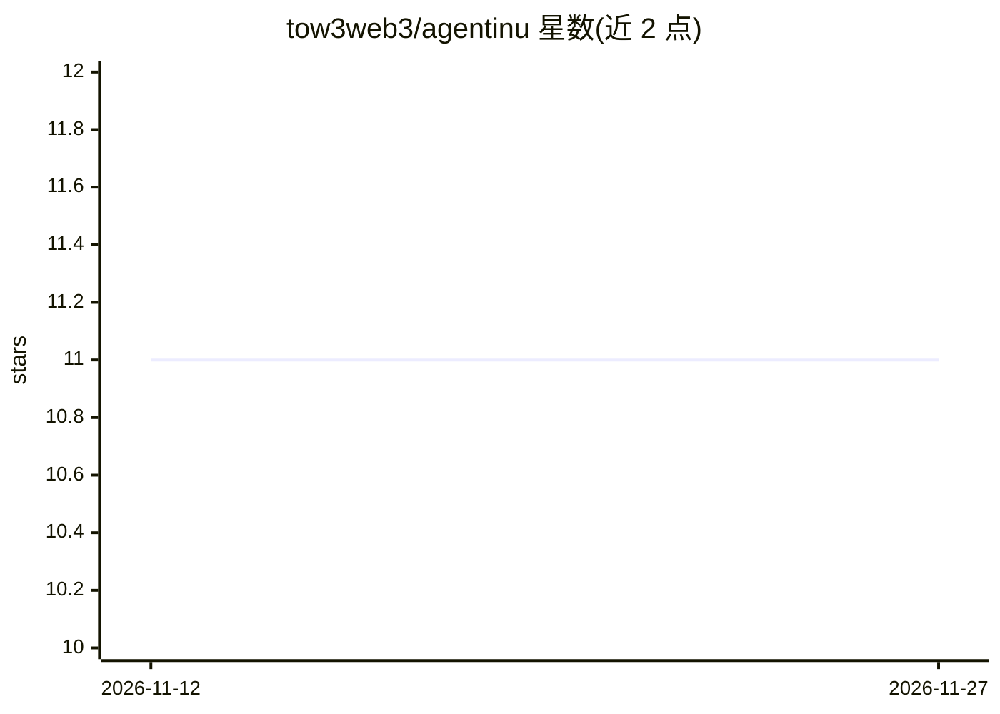

# tow3web3/agentinu

⭐ 11 · HTML · 推送 2026-02-25 · [GitHub](https://github.com/tow3web3/agentinu) · [官网](https://www.agentinu.dog/) · 个人维护

**Solana 上的 memecoin 自动交易 agent，向代币持有者分配利润**

运行于 Solana、全天候运行的自主交易程序：实时监控 pump.fun 新代币发行与 Raydium 交易对，过滤蜜罐与 rug 模式，按部署者钱包历史、LP 锁定、初始买入分布、社交信号速度与 Binance tick 动量等多因子打分，经 Claude AI 合成 conviction 分数（0-100），超阈值时通过 Jupiter V6 执行兑换，并按持仓比例将已实现利润分配给代币持有者。本地运行需 git clone 源码后执行 python3 demo.py。README 附链上钱包地址与自称的绩效统计表。

## 筛选速览

| 维度 | 判定 | 备注 |
|---|---|---|
| AI 角色 | `ai-native` | 本体是模型或模型工具 |
| 许可风险 | `none` | — |
| 部署形态 | `None` |  |
| 模型依赖 | — | README 未给出锁定关系 |
| 硬件要求 | — | 无带数字的原话,不猜 |
| 安装摩擦 | `low` | 无编译、无系统依赖或容器化 |
| 成熟度 | — | 结构信号不足 |

## 能力要点

- pump.fun 新币实时检测，过滤蜜罐/rug 模式
- 多因子信号经 Claude AI 合成 conviction 分数（0-100）驱动仓位大小
- 通过 Jupiter V6 路由执行兑换，含移动止损/止盈
- 利润按持仓比例自动链上分配给代币持有者

## 适用场景

- 全自动监控并交易 pump.fun 新发行的 memecoin
- 向代币持有者自动分配交易利润
- 用链上钱包地址核验每笔交易与分配记录

## 场景标签

`金融量化` · 领域:学习与行业

## 证据(README 行号)

> L20: Agent Inu is a fully autonomous trading bot that runs 24/7 on Solana. It monitors new token launches on pump.fun, e
> L35: **2. Analysis** — Each candidate is scored across multiple dimensions: deployer wallet history, LP lock status, ini

## 星数曲线

2026-11-12 11 → 2026-11-27 11（+0）

---
*卡片 v1 · prompt 1.4 · 生成 2026-11-18 · 置信度 high · 依据 README sha `865fbe2d7841` · [字段定义](../../DATASET.md)*
