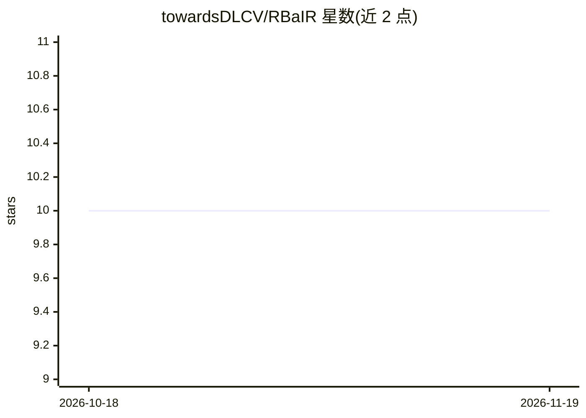

# towardsDLCV/RBaIR

⭐ 10 · Python · MIT · 推送 2026-04-10 · [GitHub](https://github.com/towardsDLCV/RBaIR) · 组织维护

**科研图像修复模型 RBaIR：多退化一体复原网络**

Pattern Recognition 论文的官方代码库，提出 RBaIR 图像修复网络，核心是动态径向基注意力模块（DyRBA）、混合卷积专家（MoCE）与 KLD 损失，支持 all-in-one 与单任务两类修复设定。仓库提供安装与数据准备说明（INSTALL.md）、all-in-one 设定下的性能结果展示，以及预训练模型下载链接和 BibTeX 引用条目。面向从事图像修复研究的科研人员。

## 筛选速览

| 维度 | 判定 | 备注 |
|---|---|---|
| AI 角色 | `ai-native` | 本体是模型或模型工具 |
| 许可风险 | `permissive` | MIT |
| 部署形态 | `None` |  |
| 模型依赖 | — | README 未给出锁定关系 |
| 硬件要求 | — | 无带数字的原话,不猜 |
| 安装摩擦 | `low` | 无编译、无系统依赖或容器化 |
| 成熟度 | — | 结构信号不足 |

## 能力要点

- DyRBA：基于 RBFN 解耦通道依赖的径向基注意力模块
- MoCE 多核设计捕捉局部与深度相关模式
- 提供预训练模型下载与 BibTeX 引用
- 代码基于 PromptIR、AdaIR、PIP 实现

## 适用场景

- 复现论文中的 all-in-one 图像修复实验
- 下载预训练模型对多种退化类型图像做修复
- 作为图像修复新模块（DyRBA/MoCE）的研究基础

## 场景标签

`图像视频处理` · 领域:感知与多模态

## 证据(README 行号)

> L12: >Recent advancements in all-in-one Image Restoration (IR) have shown great promise, yet existing methods are often 
> L16: See INSTALL.md for the installation of dependencies and dataset preperation required to run this codebase.

## 星数曲线

2026-10-18 10 → 2026-11-19 10（+0）

---
*卡片 v1 · prompt 1.4 · 生成 2026-11-19 · 置信度 high · 依据 README sha `68ad55303ff8` · [字段定义](../../DATASET.md)*
