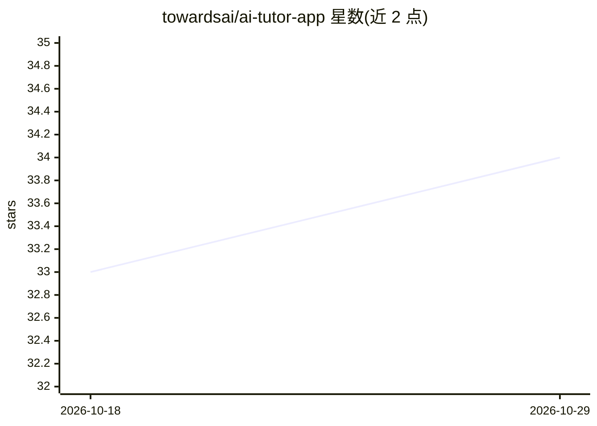

# towardsai/ai-tutor-app

⭐ 34 · Python · Apache-2.0 · 推送 2026-10-22 · [GitHub](https://github.com/towardsai/ai-tutor-app) · 组织维护

**面向应用 AI/LLM/RAG/Python 学习的 agentic RAG 导师应用**

Towards AI 团队构建的对话式 AI 导师：Next.js 前端 + FastAPI 后端，核心为 LangChain/LangGraph agent，基于精选课程与库语料做接地回答。聊天模型 provider 无关（默认 DeepSeek API，可回退 Gemini，支持 OpenAI/Anthropic/OpenRouter key）；除向量检索（Chroma）外，agent 可浏览 data/kb/ 下三层文件知识库（raw/wiki/generated）。支持 LangSmith 全链路追踪，前端以独立 UI 元素呈现来源、工具活动与推理。已部署于 Hugging Face Spaces。

## 筛选速览

| 维度 | 判定 | 备注 |
|---|---|---|
| AI 角色 | `ai-native` | 本体是模型或模型工具 |
| 许可风险 | `permissive` | Apache-2.0 |
| 部署形态 | `library` | 以包/库形式分发 |
| 模型依赖 | locked-api |  |
| 硬件要求 | — | 无带数字的原话,不猜 |
| 安装摩擦 | `low` | 无编译、无系统依赖或容器化 |
| 成熟度 | — | 结构信号不足 |

## 能力要点

- LangGraph agent + Chroma 向量检索的 agentic RAG 接地回答
- 文件式三层知识库（raw/wiki/generated），agent 可用只读命令浏览
- provider 无关的模型配置（deepseek:deepseek-v4-flash 默认，Gemini 回退）
- LangSmith 逐轮 agent 追踪，前端分离渲染来源与工具活动

## 适用场景

- 学习应用 AI、LLM、RAG 与 Python 时获得有出处的答疑
- 在自有语料上构建并部署生产级 AI 导师
- 参考其架构做 agent RAG 与知识库维护实践

## 场景标签

`聊天机器人` `RAG` · 领域:对话与助手

## 证据(README 行号)

> L11: An agentic RAG tutor for applied AI, LLMs, RAG, and Python: a Next.js frontend served by a FastAPI backend, with a 
> L15: The live app is deployed on Hugging Face Spaces at: AI Tutor Chatbot on Hugging Face (prod).

## 星数曲线

2026-10-18 33 → 2026-10-29 34（+1）

---
*卡片 v1 · prompt 1.4 · 生成 2026-10-25 · 置信度 high · 依据 README sha `9a873bc4ddf1` · [字段定义](../../DATASET.md)*
