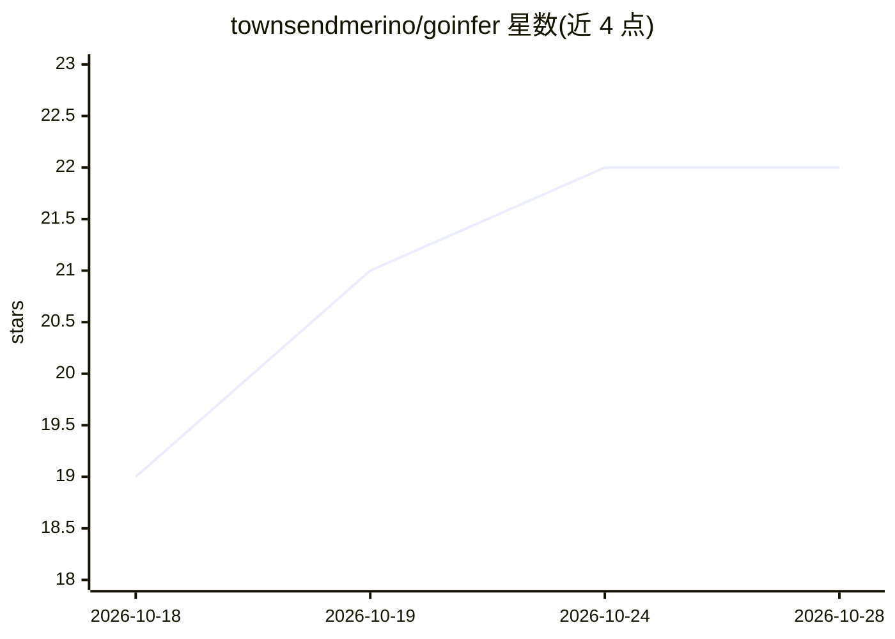

# townsendmerino/goinfer

⭐ 22 · Go · MIT · 推送 2026-10-27 · [GitHub](https://github.com/townsendmerino/goinfer) · 个人维护

**纯 Go 无 cgo 的本地 LLM 推理库与服务器，单静态二进制运行开放权重模型**

以纯 Go（CGO_ENABLED=0）实现的本地 LLM 推理方案：可作为 Go 库 go get 引入，也可作为预编译单二进制运行——goinfer-serve 提供 OpenAI 与 Anthropic 兼容 API 及内置 Web UI，goinfer-chat 为单次对话运行时。从 HuggingFace 拉取 GGUF 或 safetensors 权重，支持 43 个模型家族、CPU/CUDA/Metal 后端（WebGPU 为可选 cgo 构建）。特色机制包括基于增量字节级语法的 JSON Schema/Go struct 约束生成（logit mask 保证输出合法）、每字段置信度捕获，以及把模型权重嵌入单一二进制的分发管线。面向 Go 工程师与需要在程序内嵌 LLM 的开发者。

## 筛选速览

| 维度 | 判定 | 备注 |
|---|---|---|
| AI 角色 | `ai-ecosystem` | LLM/agent 周边工具 |
| 许可风险 | `permissive` | MIT |
| 部署形态 | `library` | 以包/库形式分发 |
| 模型依赖 | locked-api |  |
| 硬件要求 | — | 无带数字的原话,不猜 |
| 安装摩擦 | `medium` | 含编译或系统依赖之一 |
| 成熟度 | — | 结构信号不足 |

## 能力要点

- 纯 Go、无 cgo，交叉编译为单一静态二进制，可将模型权重一并嵌入
- 43 个模型家族，读取 safetensors 与 GGUF（15 种类型），CPU/CUDA/Metal 支持
- JSON Schema / Go struct 约束生成：违反 schema 的 token 在 logit 层被屏蔽
- goinfer-serve 提供 OpenAI/Anthropic 兼容 API、多模型、视觉、嵌入与管理接口

## 适用场景

- 在 Go 程序中嵌入本地 LLM 推理，无需 Python 或 C 工具链
- 用单文件二进制在离线/air-gapped 环境分发带模型的演示
- 把结构化输出（JSON Schema 约束）直接集成进类型安全的 Go 代码
- 在树莓派等小内存 ARM 板上运行小模型

## 场景标签

`推理引擎` · 领域:训练与推理

## 证据(README 行号)

> L6: **Run an open-weight LLM inside your Go program.** Pure Go, no cgo: `go get` it, import it,
> L15: Also ships as a ready-made server (`goinfer-serve`: OpenAI and Anthropic APIs, web UI) and a
> L99: |`goinfer-serve-<os>-<arch>`|the **server** — OpenAI + Anthropic APIs, web UI, GPU built in|

## 星数曲线

2026-10-18 19 → 2026-10-28 22（+3）

---
*卡片 v1 · prompt 1.4 · 生成 2026-10-27 · 置信度 high · 依据 README sha `38b1f38ef680` · [字段定义](../../DATASET.md)*
