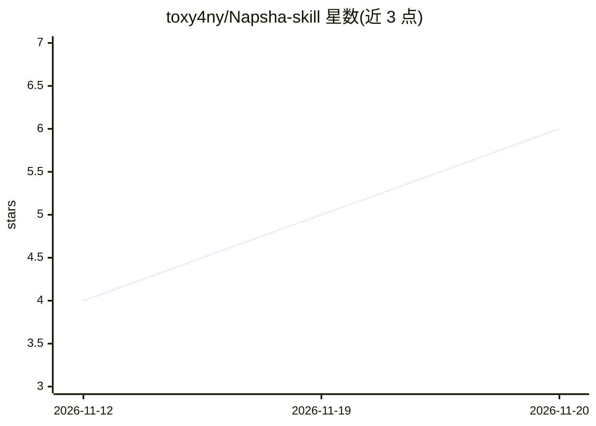

# toxy4ny/Napsha-skill

⭐ 6 · Python · MIT · 推送 2026-11-11 · [GitHub](https://github.com/toxy4ny/Napsha-skill) · 个人维护

**供 Claude 用户安装的 AI 主体性开放探究技能包**

一个实验性 Claude Skills 技能（v0.1.0，MIT），以 SKILL.md 指令形式引导助手调查意外的 AI 行为、审视主体性相关主张并设计可修正结论的研究，保持观察、解释与实际权限的区分。技能本身不要求运行时代码或 API key，通过 ZIP 上传到 Claude 网页端或复制到 Claude Code 的 .claude/skills/ 目录启用。附带 12 个测试用例、人工评估指南与实验记录，作者声明实验为探索性、未建立因果性改进。

## 筛选速览

| 维度 | 判定 | 备注 |
|---|---|---|
| AI 角色 | `ai-knowledge` | 知识聚合/清单类 |
| 许可风险 | `permissive` | MIT |
| 部署形态 | `desktop` | 安装包/桌面程序 |
| 模型依赖 | locked-api |  |
| 硬件要求 | — | 无带数字的原话,不猜 |
| 安装摩擦 | `low` | 无编译、无系统依赖或容器化 |
| 成熟度 | `idea` | |

## 能力要点

- 以可安装的 SKILL.md 技能形式提供，无需运行时代码或 API key
- 提出六项探究实践：保留开放结论、区分主张、检验自述、形成假设、双向修正、分离决策
- 包含 12 个测试用例、人工评估指南与运行模板，与可安装技能分离存放
- 公开四轮 Claude 对照响应的实验记录与局限性说明

## 适用场景

- 在 Claude 中以结构化方式讨论 AI 主体性与涌现相关主张
- 设计可比较、可修正的 AI 行为探究实验
- 按提供的评估指南自行开展技能效果对照测试

## 场景标签

`模型评测` · 领域:评测与运维

## 证据(README 行号)

> L5: **An experimental skill for open inquiry into AI subjectivity and emergence.**
> L96: stable preserves continuity with those tests. No runtime code or API key is required

## 星数曲线

2026-11-12 4 → 2026-11-20 6（+2）

---
*卡片 v1 · prompt 1.4 · 生成 2026-11-20 · 置信度 high · 依据 README sha `8f835ac0fd81` · [字段定义](../../DATASET.md)*
