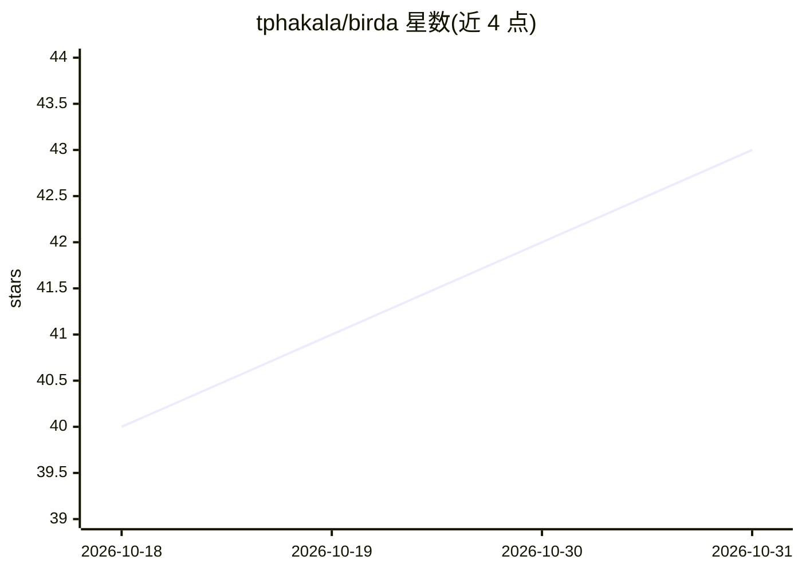

# tphakala/birda

⭐ 43 · Rust · MIT · 推送 2026-10-29 · [GitHub](https://github.com/tphakala/birda) · 个人维护

**用 BirdNET/Perch 模型检测鸟类物种的 CLI 工具**

Rust 编写的跨平台命令行工具，读取音频文件，用 BirdNET v2.4/v3.0、Google Perch v2、BSG Finnish Birds 及 BattyBirdNET 蝙蝠分类器进行鸟类（及蝙蝠）物种检测。支持可选 CUDA 与 TensorRT GPU 推理（CUDA 包捆绑 ONNX Runtime 与 CUDA 库），可按位置/日期用 BirdNET Geomodel（12,012 物种）动态过滤物种或使用静态物种列表，输出 CSV/Parquet/JSON/Raven/Audacity/Kaleidoscope 多种格式，并支持按物种提取音频片段。模型通过 birda models install 命令下载，另提供单独发布的 Electron GUI。TensorRT 为可选，需另下载 TensorRT 10.x。

## 筛选速览

| 维度 | 判定 | 备注 |
|---|---|---|
| AI 角色 | `ai-native` | 本体是模型或模型工具 |
| 许可风险 | `permissive` | MIT |
| 部署形态 | `desktop` | 安装包/桌面程序 |
| 模型依赖 | — | README 未给出锁定关系 |
| 硬件要求 | `cpu-ok` | |
| 安装摩擦 | `medium` | 含编译或系统依赖之一 |
| 成熟度 | — | 结构信号不足 |

## 能力要点

- 支持 BirdNET v2.4/v3.0、Google Perch v2 等多模型推理
- 可选 CUDA/TensorRT GPU 加速（CUDA 包自带运行库）
- 基于 BirdNET Geomodel 的位置/日期物种过滤（覆盖 12,012 物种）
- 多种输出格式（CSV/Parquet/JSON/Raven/Audacity/Kaleidoscope）与按物种的片段提取

## 适用场景

- 批量分析野外录音做鸟类物种检测
- 按地点和日期过滤可能的物种以减少误检
- 从检测结果按物种提取音频片段供复核

## 场景标签

 · 领域:生物声学/生态监测

## 证据(README 行号)

> L8: A fast, cross-platform CLI tool for bird species detection using BirdNET and Google Perch AI models.
> L12: - **Multiple AI Models**: Support for BirdNET v2.4, BirdNET v3.0, Google Perch v2, BSG Finnish Birds, and BattyBird

## 星数曲线

2026-10-18 40 → 2026-10-31 43（+3）

---
*卡片 v1 · prompt 1.4 · 生成 2026-10-25 · 置信度 high · 依据 README sha `647caa4e8745` · [字段定义](../../DATASET.md)*
