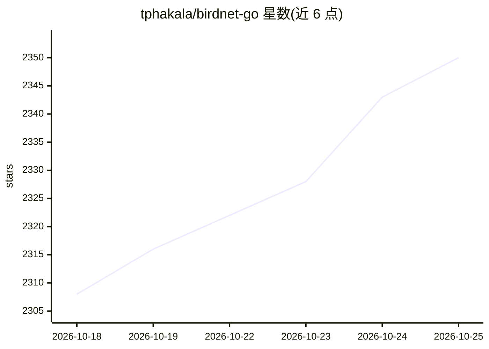

# tphakala/birdnet-go

⭐ 2,355 · Go · NOASSERTION · 推送 2026-10-25 · [GitHub](https://github.com/tphakala/birdnet-go) · 个人维护

**自托管 24/7 实时鸟鸣与蝙蝠声音识别系统，可跑在树莓派上**

用 Go 编写的实时声景分析器：从声卡或 RTSP 流采集音频，本地运行多模型推理——BirdNET v2.4（内嵌，6500+ 鸟类）、Google Perch v2（ONNX，14795 物种）、BattyBirdNET 区域蝙蝠模型（支持 256 kHz 超声）与 BirdNET Geomodel v3.0，支持多模型并行与跨模型共识提升置信度。检测结果通过 Svelte Web UI 呈现（实时频谱图、热图），并可经告警规则引擎推送到 Discord/Telegram/MQTT/Home Assistant 等渠道。默认纯本地运行，数据存 SQLite 或 MySQL，可在树莓派 4 上运行。

## 筛选速览

| 维度 | 判定 | 备注 |
|---|---|---|
| AI 角色 | `ai-native` | 本体是模型或模型工具 |
| 许可风险 | `none` | NOASSERTION |
| 部署形态 | `self-host` | docker 或自建部署 |
| 模型依赖 | — | README 未给出锁定关系 |
| 硬件要求 | — | 无带数字的原话,不猜 |
| 安装摩擦 | `low` | 无编译、无系统依赖或容器化 |
| 成熟度 | — | 结构信号不足 |

## 能力要点

- 多模型 AI 画廊：BirdNET v2.4 / Perch v2 / BattyBirdNET / Geomodel 应用内安装，无需重建
- 多模型并行推理与跨模型共识机制提升检测置信度
- 支持声卡与 RTSP 流、最高 256 kHz 采样率的蝙蝠超声检测
- 告警规则引擎接入 Discord/Telegram/MQTT(Home Assistant 自动发现)/BirdWeather 等多个目标

## 适用场景

- 在树莓派上 24/7 监测庭院或野外的鸟类声音并收到通知
- 接入 Home Assistant 做智慧家庭物种检测联动
- 用超声设备做区域蝙蝠声学监测
- 为观鸟直播（OBS）叠加实时频谱图与检测结果

## 场景标签

`语音识别` · 领域:感知与多模态

## 证据(README 行号)

> L34: **Realtime soundscape analyser for birds, wildlife, and bats.**
> L36: Self-hosted, 24/7, local AI inference. BirdNET-Go ingests soundcard input or network audio streams, runs multi-mode

## 星数曲线

2026-10-18 2,308 → 2026-10-25 2,350（+42）

---
*卡片 v1 · prompt 1.4 · 生成 2026-10-21 · 置信度 high · 依据 README sha `69be8fe60427` · [字段定义](../../DATASET.md)*
