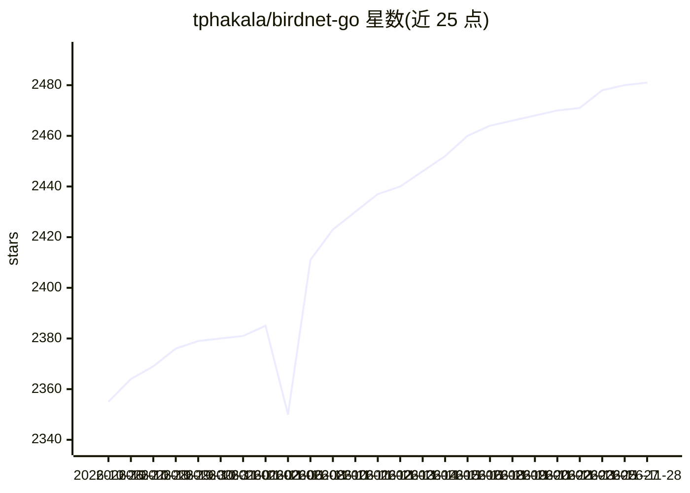

# tphakala/birdnet-go

⭐ 2,481 · Go · NOASSERTION · 推送 2026-11-27 · [GitHub](https://github.com/tphakala/birdnet-go) · 个人维护

**给自然爱好者 24/7 本地识别鸟/蝙蝠等野生动物声音**

以 Go 编写的自托管实时声景分析器：持续监听本地声卡或 RTSP 网络音频流，本地运行 BirdNET、Google Perch、BattyBirdNET 等多个模型识别物种，并在 Web 面板展示检测、频谱图与录音片段。支持应用内模型库安装、多模型并行与跨模型共识过滤、告警规则分发到 Discord/Telegram/MQTT 等多种目标。可运行于树莓派 4 等单板机，提供安装脚本、多架构 Docker 镜像与预编译二进制。许可证为 CC BY-NC-SA 4.0（非商业）。

## 筛选速览

| 维度 | 判定 | 备注 |
|---|---|---|
| AI 角色 | `ai-native` | 本体是模型或模型工具 |
| 许可风险 | `none` | NOASSERTION |
| 部署形态 | `self-host` | docker 或自建部署 |
| 模型依赖 | local-ok | 支持本地模型 |
| 硬件要求 | — | 无带数字的原话,不猜 |
| 安装摩擦 | `low` | 无编译、无系统依赖或容器化 |
| 成熟度 | — | 结构信号不足 |

## 能力要点

- 应用内模型库安装 BirdNET v2.4/v3.0、Perch v2、蝙蝠模型等，无需重新构建
- 多模型并行推理与可选的跨模型共识过滤
- 纯 Go 频谱渲染，无需 SoX；RTSP 流仅需 FFmpeg
- 告警路由至 Discord/Slack/Telegram/MQTT（含 Home Assistant 发现）等

## 适用场景

- 在树莓派或家庭服务器上 24/7 监测后院鸟鸣
- 接入 RTSP 流同时分析多个麦克风点位
- 通过 MQTT 把物种检测推送进 Home Assistant
- 用蝙蝠模型在超声波采样率下监测蝙蝠活动

## 场景标签

`语音识别` · 领域:感知与多模态

## 证据(README 行号)

> L36: BirdNET-Go listens continuously to local microphones or network audio streams, identifies species locally using Bir
> L65: - **BirdNET v2.4** (default, embedded, 6,500+ bird species)

## 星数曲线

2026-10-26 2,355 → 2026-11-28 2,481（+126）

---
*卡片 v1 · prompt 1.4 · 生成 2026-11-24 · 置信度 high · 依据 README sha `d573a952b209` · [字段定义](../../DATASET.md)*
