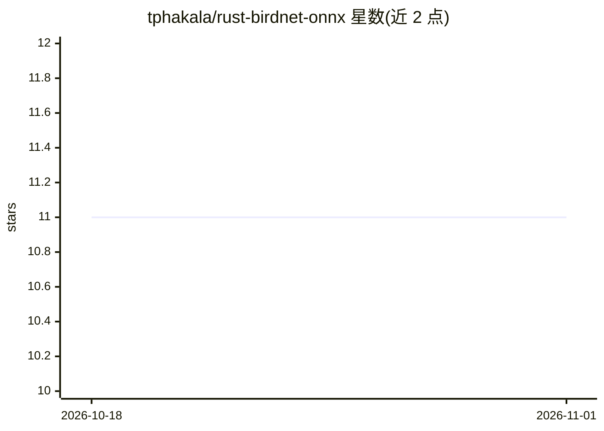

# tphakala/rust-birdnet-onnx

⭐ 11 · Rust · MIT · 推送 2026-10-22 · [GitHub](https://github.com/tphakala/rust-birdnet-onnx) · 个人维护

**Rust 库：运行 BirdNET/Perch/BSG 鸟声识别 ONNX 推理**

以 Rust 库形式运行 BirdNET v2.4/v3.0、Perch v2 与 BSG Finland 共四类鸟声识别 ONNX 模型，支持 CUDA/TensorRT GPU 加速、批处理与超时取消；提供线程安全 Classifier（builder 模式）、基于位置与日期的物种范围过滤（RangeFilter）、嵌入向量上的自定义二级分类器（如蝙蝠分类器），以及 BSG 后处理（逐物种校准与物种分布模型）。附带 CLI 工具 birdnet-analyze 分析 WAV 文件。限制：嵌入输出需补丁模型，BSG 与 v2.4 输入形状相同需显式指定模型类型。

## 筛选速览

| 维度 | 判定 | 备注 |
|---|---|---|
| AI 角色 | `ai-native` | 本体是模型或模型工具 |
| 许可风险 | `permissive` | MIT |
| 部署形态 | `library` | 以包/库形式分发 |
| 模型依赖 | — | README 未给出锁定关系 |
| 硬件要求 | — | 无带数字的原话,不猜 |
| 安装摩擦 | `high` | 编译与系统依赖俱全 |
| 成熟度 | `idea` | |

## 能力要点

- 支持 BirdNET v2.4/v3.0、Perch v2、BSG Finland 四类模型并自动检测类型
- CUDA/TensorRT GPU 加速与内存高效批处理（BatchInferenceContext）
- 基于位置与日期的 RangeFilter 物种过滤（48 周日历 meta 模型）
- 嵌入向量上运行自定义二级分类器（如 BattyBirdNET 蝙蝠分类器）

## 适用场景

- 在 Rust 项目中集成鸟声识别推理
- 批量分析野生动物录音 WAV 文件并输出 Top-K 物种预测
- 按地理位置和季节过滤物种预测结果

## 场景标签

`推理引擎` · 领域:训练与推理

## 证据(README 行号)

> L12: A Rust library for running inference on BirdNET, Perch, and BSG Finland ONNX models with CUDA GPU support.
> L16: - Support for BirdNET v2.4, v3.0, Perch v2, and BSG Finland models

## 星数曲线

2026-10-18 11 → 2026-11-01 11（+0）

---
*卡片 v1 · prompt 1.4 · 生成 2026-11-01 · 置信度 high · 依据 README sha `37b80420bb5e` · [字段定义](../../DATASET.md)*
