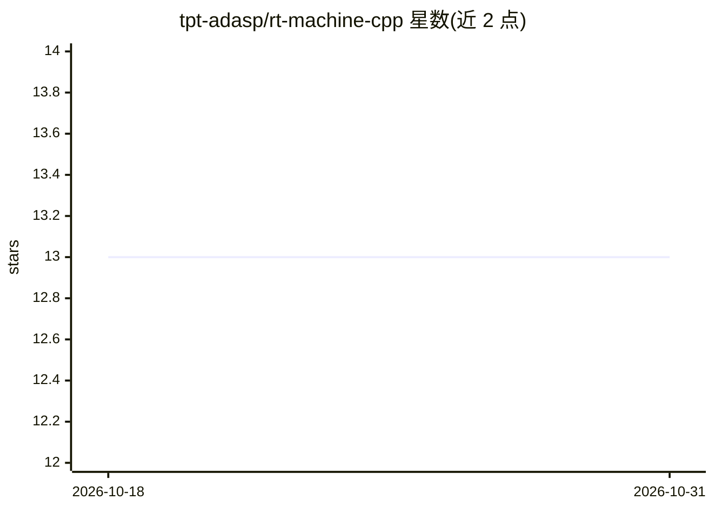

# tpt-adasp/rt-machine-cpp

⭐ 13 · C++ · NOASSERTION · 推送 2025-11-04 · [GitHub](https://github.com/tpt-adasp/rt-machine-cpp) · [官网](https://adasp.telecom-paris.fr/) · 组织维护

**构建实时音频机器学习研究原型的 C++20 框架**

面向音频 ML 研究原型开发的 C++20 框架，提供建筑模块：同步/异步/远程处理、STFT/Log-Mel 与自定义滤波器组的前后处理、以及通过 ONNX Runtime / ExecuTorch / TensorFlow Lite 的深度学习推理接入，并支持自定义处理。使用 CMake 交叉编译，覆盖 x86_64、arm64（树莓派）、Android arm64-v8a 与 iOS 16.1 平台。README 声明因 ADASP 无人维护而开源，部分后端（fftw/onnxruntime/tflite）并非实时安全，仅 ExecuTorch 与 signalsmith FFT 后端标注为实时安全。

## 筛选速览

| 维度 | 判定 | 备注 |
|---|---|---|
| AI 角色 | `ai-ecosystem` | LLM/agent 周边工具 |
| 许可风险 | `none` | NOASSERTION |
| 部署形态 | `None` |  |
| 模型依赖 | — | README 未给出锁定关系 |
| 硬件要求 | — | 无带数字的原话,不猜 |
| 安装摩擦 | `medium` | 含编译或系统依赖之一 |
| 成熟度 | — | 结构信号不足 |

## 能力要点

- 同步/异步/远程处理与 STFT/Log-Mel 前后处理模块
- 三种推理后端可选：ONNX Runtime / ExecuTorch / TensorFlow Lite
- 跨平台 CMake 构建：x86_64、树莓派 arm64、Android、iOS
- 经 rtsan 测试并标注各后端的实时安全状态

## 适用场景

- 在嵌入式与移动平台搭建实时音频 ML 原型
- 研究实时推理后端的选择与安全性行为
- 用统一框架做音频信号前后处理加推理的流水线实验

## 场景标签

`科研工具` `推理引擎` · 领域:学习与行业

## 证据(README 行号)

> L2: `rt-machine-cpp` is a C++20 framework designed to build real-time audio machine-learning research prototypes.
> L7:  - Deep-learning inference: Onnxruntime / Executorch / Tensorflow Lite

## 星数曲线

2026-10-18 13 → 2026-10-31 13（+0）

---
*卡片 v1 · prompt 1.4 · 生成 2026-10-31 · 置信度 high · 依据 README sha `711ec4973642` · [字段定义](../../DATASET.md)*
