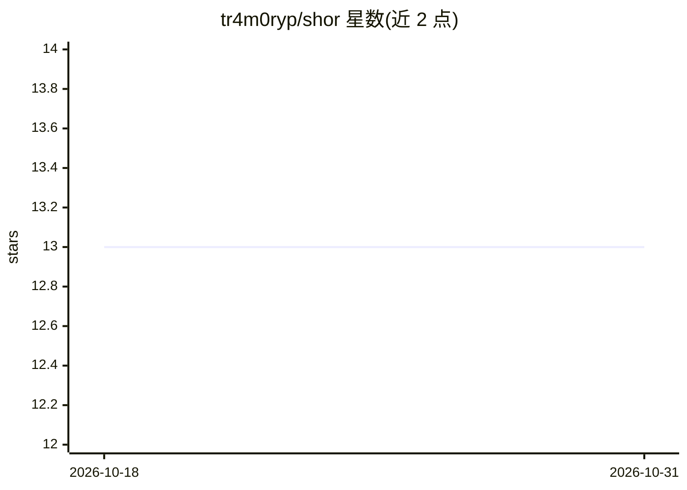

# tr4m0ryp/shor

⭐ 13 · TypeScript · NOASSERTION · 推送 2026-10-25 · [GitHub](https://github.com/tr4m0ryp/shor) · 个人维护

**自主 Web 应用渗透测试引擎：多 agent 流水线产出经验证的漏洞**

面向 Web 应用的自主攻击性安全扫描平台：以多租户形式运行，用户在 Web 仪表板接入目标 URL（黑盒）或额外连接源码仓库（白盒），每次扫描由隔离沙箱中的 worker 执行约 17 个固定角色的专家 agent 流水线，外加规模可变的对抗评审团。agent 以可调用技能形式使用 30+ 安全工具（nmap、sqlmap、semgrep 等），每个候选漏洞须经多数投票筛选、真实利用与确定性 PoC 回放复核，仅报告已复现的发现，输出含攻击面图、报告、SARIF 导出与只读分享链接。强制签署 Rules of Engagement，默认拒绝范围外主机，仅限授权测试。许可为 PolyForm Noncommercial 1.0.0（source-available，非 OSI 开源）。

## 筛选速览

| 维度 | 判定 | 备注 |
|---|---|---|
| AI 角色 | `ai-native` | 本体是模型或模型工具 |
| 许可风险 | `none` | NOASSERTION |
| 部署形态 | `None` |  |
| 模型依赖 | — | README 未给出锁定关系 |
| 硬件要求 | — | 无带数字的原话,不猜 |
| 安装摩擦 | `low` | 无编译、无系统依赖或容器化 |
| 成熟度 | — | 结构信号不足 |

## 能力要点

- 约 17 个固定角色专家 agent + 对抗评审团的渗透流水线
- 确定性 PoC 回放复核：发现须实际复现才算确认
- 30+ 真实安全工具（nmap/sqlmap/semgrep/nuclei 等）以技能形式供 agent 调用
- 白盒模式接入源码仓库，发现可定位到具体文件与行号

## 适用场景

- 对自己的 Web 应用做授权渗透测试并获得经验证的漏洞清单
- 在白盒模式下将漏洞定位到源码行并跟踪跨扫描的新增/复发/已解决状态
- 安全团队通过只读链接与 SARIF 导出共享扫描结果

## 场景标签

`多智能体` `网络安全` · 领域:Agent 开发

## 证据(README 行号)

> L7: AI agents does what a human penetration tester would: map the app, reason about
> L37: A scan is not one big model call. It's a pipeline of specialist agents, each its own
> L126: Shor's agents don't just reason — they wield 30+ real offensive-security tools,

## 星数曲线

2026-10-18 13 → 2026-10-31 13（+0）

---
*卡片 v1 · prompt 1.4 · 生成 2026-10-31 · 置信度 high · 依据 README sha `216024a8e851` · [字段定义](../../DATASET.md)*
