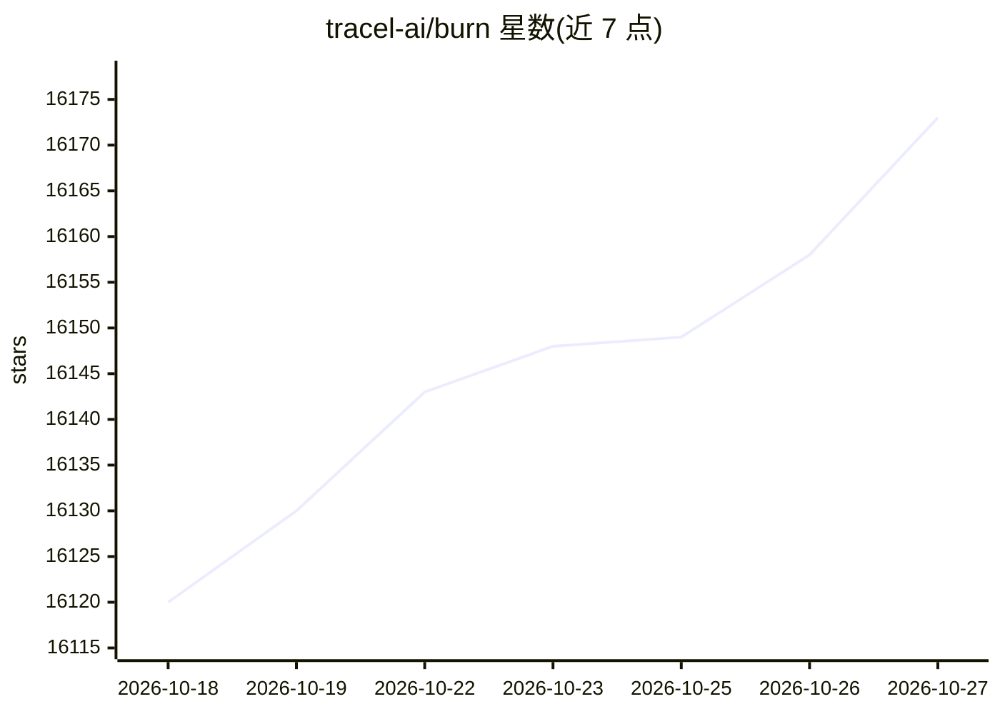

# tracel-ai/burn

⭐ 16,173 · Rust · Apache-2.0 · 推送 2026-10-26 · [GitHub](https://github.com/tracel-ai/burn) · [官网](https://burn.dev) · 组织维护

**给 Rust 开发者的训练+推理统一张量库与深度学习框架**

Burn 是同时作为张量库与深度学习框架的 Rust 项目，通过统一 API 执行多平台张量运算，使训练代码与生产部署代码一致。基于 CubeCL 的后端覆盖 CUDA、ROCm、Metal、Vulkan、WebGPU 及 CPU，并可通过 autodiff、kernel fusion、remote 执行等装饰器组合；同一应用内可启用多后端并在运行时选择设备。提供训练 TUI 仪表盘、burn-onnx 导入、PyTorch/Safetensors 权重加载及 WebAssembly 浏览器推理。LibTorch 后端在 0.22.0 起废弃并已从 main 移除。

## 筛选速览

| 维度 | 判定 | 备注 |
|---|---|---|
| AI 角色 | `ai-ecosystem` | LLM/agent 周边工具 |
| 许可风险 | `permissive` | Apache-2.0 |
| 部署形态 | `library` | 以包/库形式分发 |
| 模型依赖 | — | README 未给出锁定关系 |
| 硬件要求 | — | 无带数字的原话,不猜 |
| 安装摩擦 | `medium` | 含编译或系统依赖之一 |
| 成熟度 | — | 结构信号不足 |

## 动量与使用信号

- 维护:`active` — 距上次 push 1.5 天,年发版 21,346 位贡献者
- 涨星:近 1 天 **+7**(自 20261016 起算)

## 能力要点

- 单一统一 API 覆盖训练与推理，多平台后端可运行时切换
- JIT 编译张量运算流并自动 kernel fusion
- autodiff、fusion、remote 后端装饰器可组合
- burn-onnx 将 ONNX 模型转成原生 Rust 代码

## 适用场景

- 在 Rust 中从原型到部署用同一套代码训练和运行模型
- 把 PyTorch/TensorFlow 导出的 ONNX 模型迁到 Rust 后端运行
- 在浏览器（WebAssembly）或嵌入式设备上做推理
- 云端训练后部署到用户不同硬件设备上

## 场景标签

`模型训练` `推理引擎` · 领域:训练与推理

## 证据(README 行号)

> L9: **Burn is both a tensor library and a deep learning framework, optimized for numerical
> L17: Burn unifies the two. By executing multi-platform tensor operations via a single, unified API, the
> L50: Burn's CubeCL backends (CUDA, ROCm, Metal, Vulkan, WebGPU,

## 星数曲线

2026-10-18 16,120 → 2026-10-27 16,173（+53）

---
*卡片 v1 · prompt 1.4 · 生成 2026-10-18 · 置信度 high · 依据 README sha `f25f7cba1eaf` · [字段定义](../../DATASET.md)*
