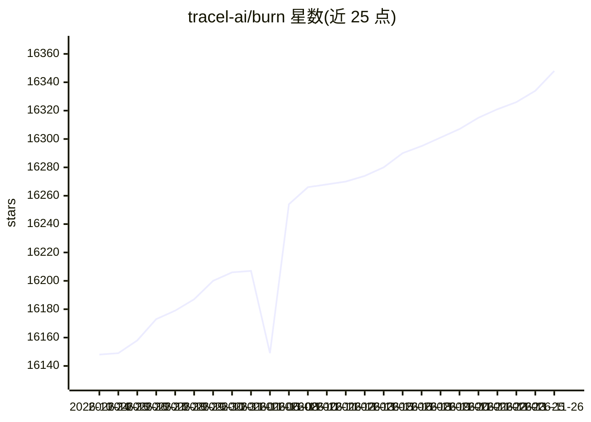

# tracel-ai/burn

⭐ 16,348 · Rust · Apache-2.0 · 推送 2026-11-25 · [GitHub](https://github.com/tracel-ai/burn) · [官网](https://burn.dev) · 组织维护

**面向 Rust 开发者的深度学习框架与张量库**

用 Rust 编写的张量库与深度学习框架，统一训练与推理：同一份模型代码可在云、桌面、嵌入式与浏览器（WebAssembly/WebGPU）执行，避免训练后导出 ONNX 等中间格式带来的损失。机制上通过 JIT 编译张量操作实现自动 kernel fusion，提供 autodiff、fusion、remote 执行等后端装饰器，可在 CUDA/ROCm/Metal/Vulkan/WebGPU/CPU 后端间切换，并支持从 PyTorch、Safetensors、ONNX 导入权重。LibTorch 后端已在 0.22.0 弃用。

## 筛选速览

| 维度 | 判定 | 备注 |
|---|---|---|
| AI 角色 | `ai-native` | 本体是模型或模型工具 |
| 许可风险 | `permissive` | Apache-2.0 |
| 部署形态 | `library` | 以包/库形式分发 |
| 模型依赖 | — | README 未给出锁定关系 |
| 硬件要求 | — | 无带数字的原话,不猜 |
| 安装摩擦 | `medium` | 含编译或系统依赖之一 |
| 成熟度 | — | 结构信号不足 |

## 动量与使用信号

- 维护:`active` — 距上次 push 1.5 天,年发版 21,346 位贡献者
- 涨星:近 1 天 **+7**(自 20261016 起算)

## 能力要点

- 训练与推理统一代码路径，支持设备端个性化与联邦学习类负载
- 多后端（CUDA/ROCm/Metal/Vulkan/WebGPU/CPU/no_std）同一 API 可切换
- autodiff 与 kernel fusion 作为后端装饰器组合使用
- burn-onnx 导入 ONNX 模型为原生 Rust 代码，支持 PyTorch/Safetensors 权重加载

## 适用场景

- 用 Rust 从原型到部署训练和运行神经网络
- 在浏览器或嵌入式设备上运行模型推理
- 将 PyTorch/TensorFlow 模型经 ONNX 迁移到 Rust 技术栈
- 跨 CUDA/AMD/Apple GPU 与 CPU 训练同一份模型代码

## 场景标签

`推理引擎` `模型训练` · 领域:训练与推理

## 证据(README 行号)

> L13:  A tensor library and deep learning framework for numerical computing, training and inference.
> L20: Burn unifies the two. By executing multi-platform tensor operations via a single, unified API, the
> L25: Burn preserves the intuitive ergonomics of PyTorch, with dynamic shapes and graphs, but JIT-compiles

## 星数曲线

2026-10-24 16,148 → 2026-11-26 16,348（+200）

---
*卡片 v1 · prompt 1.4 · 生成 2026-11-22 · 置信度 high · 依据 README sha `f9a6b0e2098d` · [字段定义](../../DATASET.md)*
