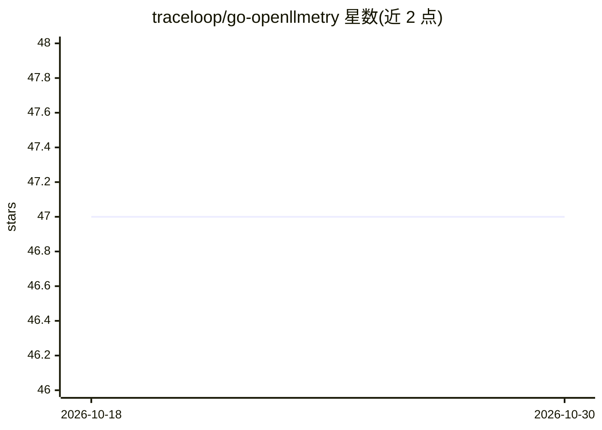

# traceloop/go-openllmetry

⭐ 47 · Go · Apache-2.0 · 推送 2026-01-17 · [GitHub](https://github.com/traceloop/go-openllmetry) · [官网](https://www.traceloop.com/openllmetry) · 组织维护

**面向 Go 的 LLM 应用可观测性 SDK，基于 OpenTelemetry**

OpenLLMetry 的 Go 语言姊妹项目，由 Traceloop 团队维护。提供构建于 OpenTelemetry 之上的扩展集：包含针对 LLM 提供商与向量数据库的标准 OpenTelemetry instrumentations，以及 traceloop-sdk 帮助快速接入。追踪数据可导出到 Datadog、Honeycomb、New Relic、Langfuse 等 18 个已测试的目的地。项目自述处于 early-alpha 探索阶段，Go 生态官方 LLM 库较少，当前需手动记录 prompts。

## 筛选速览

| 维度 | 判定 | 备注 |
|---|---|---|
| AI 角色 | `ai-ecosystem` | LLM/agent 周边工具 |
| 许可风险 | `permissive` | Apache-2.0 |
| 部署形态 | `None` |  |
| 模型依赖 | — | README 未给出锁定关系 |
| 硬件要求 | — | 无带数字的原话,不猜 |
| 安装摩擦 | `low` | 无编译、无系统依赖或容器化 |
| 成熟度 | `idea` | |

## 能力要点

- 基于 OpenTelemetry 标准的 LLM 应用追踪 SDK
- 支持 18 个已测试的追踪导出目的地（Datadog/Honeycomb/Langfuse 等）
- 提供 traceloop-sdk 一行 go get 安装并快速接入
- 包含针对 LLM 提供商与向量数据库的 instrumentations

## 适用场景

- 为 Go 编写的 LLM 应用添加追踪与可观测性
- 将 LLM 调用追踪数据接入已有的 Datadog/Honeycomb 等观测栈
- 在已部署 OpenTelemetry 的系统中直接添加 LLM instrumentations

## 场景标签

`LLM 可观测性` · 领域:评测与运维

## 证据(README 行号)

> L35: OpenLLMetry is a set of extensions built on top of OpenTelemetry that gives you complete observability over your LL
> L39: The repo contains standard OpenTelemetry instrumentations for LLM providers and Vector DBs, as well as a Traceloop 

## 星数曲线

2026-10-18 47 → 2026-10-30 47（+0）

---
*卡片 v1 · prompt 1.4 · 生成 2026-10-25 · 置信度 high · 依据 README sha `72077455b55c` · [字段定义](../../DATASET.md)*
