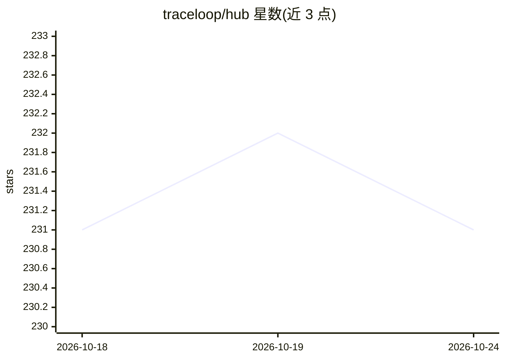

# traceloop/hub

⭐ 231 · Rust · Apache-2.0 · 推送 2026-07-16 · [GitHub](https://github.com/traceloop/hub) · [官网](https://www.traceloop.com/docs/hub) · 组织维护

**Rust 编写的 LLM 网关：统一 OpenAI 兼容 API 接多家提供商**

面向需要集中管理与追踪 LLM 调用的开发/运维场景：以单一 OpenAI 兼容 API 接入 OpenAI、Anthropic、Azure OpenAI、AWS Bedrock、Google VertexAI 等提供商。提供两种部署模式——YAML 静态配置（无外部依赖）与 PostgreSQL 数据库模式（含 Management API、热重载）。内置 OpenTelemetry 追踪与 Prometheus 指标，支持 Helm 与 Docker Compose 部署。Apache-2.0 许可，由 Traceloop 维护。

## 筛选速览

| 维度 | 判定 | 备注 |
|---|---|---|
| AI 角色 | `ai-ecosystem` | LLM/agent 周边工具 |
| 许可风险 | `permissive` | Apache-2.0 |
| 部署形态 | `self-host` | docker 或自建部署 |
| 模型依赖 | locked-api |  |
| 硬件要求 | — | 无带数字的原话,不猜 |
| 安装摩擦 | `low` | 无编译、无系统依赖或容器化 |
| 成熟度 | — | 结构信号不足 |

## 能力要点

- 单一 OpenAI 兼容 API 接入多家 LLM 提供商
- YAML / PostgreSQL 两种部署模式，数据库模式支持热重载
- 内置 OpenTelemetry 追踪与 Prometheus 指标
- 提供 Docker 与 Helm Chart 部署方式

## 适用场景

- 统一团队对多家 LLM 提供商的调用入口
- 对 LLM 请求做集中追踪与指标监控
- 通过 Management API 动态增删提供商与模型配置

## 场景标签

 · 领域:LLM 基础设施/网关与可观测性

## 证据(README 行号)

> L38: Traceloop Hub is a next-gen high-performance LLM gateway written in Rust that centralizes control and tracing of al
> L47: - **Built-in Observability**: OpenTelemetry tracing and Prometheus metrics

## 星数曲线

2026-10-18 231 → 2026-10-24 231（+0）

---
*卡片 v1 · prompt 1.4 · 生成 2026-10-22 · 置信度 high · 依据 README sha `57c62d0bcc3f` · [字段定义](../../DATASET.md)*
