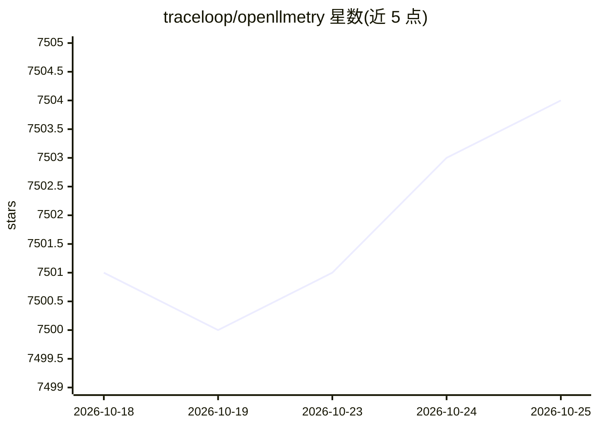

# traceloop/openllmetry

⭐ 7,506 · Python · Apache-2.0 · 推送 2026-10-19 · [GitHub](https://github.com/traceloop/openllmetry) · [官网](https://www.traceloop.com/openllmetry) · 组织维护

**基于 OpenTelemetry 的 LLM 应用可观测性插桩集**

由 Traceloop 维护的 GenAI/LLM 应用可观测性开源项目：在 OpenTelemetry 之上构建一组标准插桩（instrumentations），覆盖 OpenAI/Anthropic/Bedrock/Ollama 等 LLM 提供商、Chroma/Pinecone/Qdrant 等向量数据库以及 LangChain/LlamaIndex 等框架，另提供 traceloop-sdk 便于快速接入。输出标准 OpenTelemetry 数据，可连接 Datadog、Honeycomb、Grafana、New Relic 等 20 余个已测试的可观测性后端。Apache-2.0 许可，v0.49.2 起 SDK 不再收集遥测数据。

## 筛选速览

| 维度 | 判定 | 备注 |
|---|---|---|
| AI 角色 | `ai-ecosystem` | LLM/agent 周边工具 |
| 许可风险 | `permissive` | Apache-2.0 |
| 部署形态 | `library` | 以包/库形式分发 |
| 模型依赖 | local-ok | 支持本地模型 |
| 硬件要求 | — | 无带数字的原话,不猜 |
| 安装摩擦 | `low` | 无编译、无系统依赖或容器化 |
| 成熟度 | — | 结构信号不足 |

## 能力要点

- LLM 提供商、向量数据库、AI 框架三类插桩覆盖
- Traceloop SDK 两行代码即可启用追踪
- 支持连接 20 余个已测试的可观测性后端
- 语义约定已成为 OpenTelemetry 的一部分

## 适用场景

- 为 LLM 应用添加调用链追踪并接入现有可观测性平台
- 监控对 OpenAI/Anthropic/Ollama 等模型的调用
- 追踪 LangChain/LlamaIndex 应用与向量数据库操作

## 场景标签

`LLM 可观测性` · 领域:评测与运维

## 证据(README 行号)

> L47: OpenLLMetry is a set of extensions built on top of OpenTelemetry that gives you complete observability over your LL
> L51: The repo contains standard OpenTelemetry instrumentations for LLM providers and Vector DBs, as well as a Traceloop 

## 星数曲线

2026-10-18 7,501 → 2026-10-25 7,504（+3）

---
*卡片 v1 · prompt 1.4 · 生成 2026-10-20 · 置信度 high · 依据 README sha `0210be2eaa3d` · [字段定义](../../DATASET.md)*
