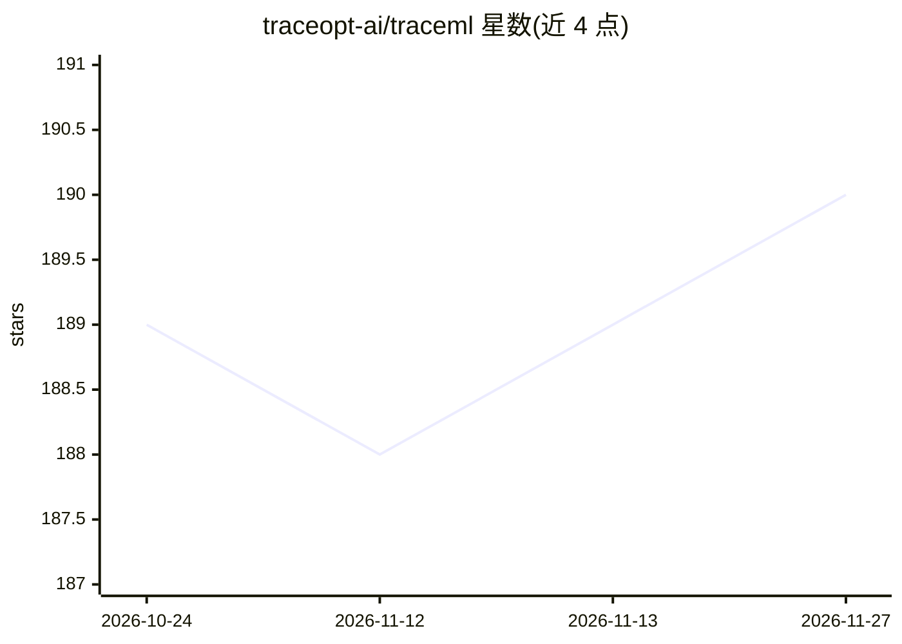

# traceopt-ai/traceml

⭐ 190 · Python · Apache-2.0 · 推送 2026-11-26 · [GitHub](https://github.com/traceopt-ai/traceml) · [官网](https://traceopt.ai/) · 组织维护

**诊断 PyTorch 训练慢因、对比运行并在 CI 拦截性能回退的工具**

嵌入 PyTorch 训练流程的性能诊断工具：分解 training-step 耗时、给出瓶颈判定（input-bound/compute-bound/rank straggler 等）并保存报告。对 Hugging Face Trainer、PyTorch Lightning、RF-DETR 等标准 API 自动接入，自定义循环通过 traceml.init() 埋点；支持用 traceml run 替代 torchrun 做多节点分布式诊断与 straggler 定位；可将逐 step、逐 rank 遥测导出为 JSONL 或自定义后端；traceml compare 支持两次运行对比并可作为 CI 门禁返回退出码。以 pip 包分发，Apache 2.0 许可。

## 筛选速览

| 维度 | 判定 | 备注 |
|---|---|---|
| AI 角色 | `ai-ecosystem` | LLM/agent 周边工具 |
| 许可风险 | `permissive` | Apache-2.0 |
| 部署形态 | `library` | 以包/库形式分发 |
| 模型依赖 | — | README 未给出锁定关系 |
| 硬件要求 | — | 无带数字的原话,不猜 |
| 安装摩擦 | `low` | 无编译、无系统依赖或容器化 |
| 成熟度 | — | 结构信号不足 |

## 能力要点

- 标准 Trainer API 自动接入，无需修改训练脚本
- 多节点 DDP/FSDP 的 rank straggler 定位与跨节点 step 对齐
- JSONL/自定义后端实时遥测导出与运行对比
- CI 性能回退门禁，输出 JSON/文本报告与退出码

## 适用场景

- 定位 PyTorch 训练变慢的瓶颈环节
- 诊断多 GPU/多节点训练中的拖尾 rank
- 在 CI 中对比新旧运行、拦截性能回退
- 更换 DataLoader/批大小/硬件后量化前后差异

## 场景标签

`MLOps` · 领域:训练与推理

## 证据(README 行号)

> L26: TraceML breaks down training-step time, identifies likely bottlenecks,
> L29: - **Trainer integrations:** automatic setup for supported trainers;

## 星数曲线

2026-10-24 189 → 2026-11-27 190（+1）

---
*卡片 v1 · prompt 1.4 · 生成 2026-11-27 · 置信度 high · 依据 README sha `f190d8b1a10d` · [字段定义](../../DATASET.md)*
