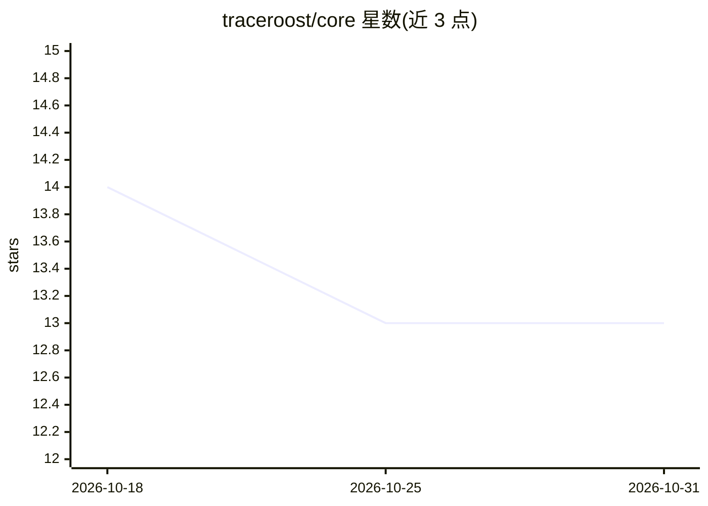

# traceroost/core

⭐ 13 · TypeScript · MIT · 推送 2026-10-27 · [GitHub](https://github.com/traceroost/core) · [官网](https://marketplace.visualstudio.com/items?itemName=agentlens.agentlens-dashboard) · 组织维护

**本地化 agentic AI 编码工具监控：追踪、成本与效率分析**

面向使用 Claude Code、Codex、GitHub Copilot、OpenCode、Cursor CLI 等 AI 编码代理的开发者的本地监控与可观测工具。通过内置 OpenTelemetry 接收器实时采集 trace（span 时序、TTFT、工具延迟、文件 diff），并读取各代理自动写出的本地日志文件（含 OpenCode SQLite）作为零配置回退来源，两路数据汇入同一仪表盘。提供 trace 分析、成本估算、16 种卡壳信号检测、写入 CLAUDE.md/AGENTS.md 的 Advisor 建议与 MCP 服务器。默认不上传数据，除非连接 TraceRoost Cloud。

## 筛选速览

| 维度 | 判定 | 备注 |
|---|---|---|
| AI 角色 | `ai-ecosystem` | LLM/agent 周边工具 |
| 许可风险 | `permissive` | MIT |
| 部署形态 | `desktop` | 安装包/桌面程序 |
| 模型依赖 | — | README 未给出锁定关系 |
| 硬件要求 | — | 无带数字的原话,不猜 |
| 安装摩擦 | `low` | 无编译、无系统依赖或容器化 |
| 成熟度 | — | 结构信号不足 |

## 能力要点

- 内置 OTel 接收器（端口 4318）实时采集 trace，本地日志读取作零配置回退
- 16 种卡壳信号（重复工具调用、振荡编辑、递归错误等）并附可粘贴的纠正提示
- Advisor 跨 trace 分析并生成可直接追加到 CLAUDE.md/AGENTS.md 的指令建议
- MCP 服务器（端口 4316）向 agent 暴露其历史 trace、成本与循环模式

## 适用场景

- 查看 AI 编码代理每次运行内部发生了什么（时序、工具调用、文件变更）
- 追踪 token 用量、估算成本与订阅计划额度消耗
- 发现卡住的 agent 并获取可粘贴的纠正提示
- 基于 trace 数据改进 CLAUDE.md/AGENTS.md 指令文件

## 场景标签

`LLM 可观测性` · 领域:评测与运维

## 证据(README 行号)

> L11: Local monitoring and observability for agentic AI coding tools — see what's actually happening inside each run. Tra
> L13: TraceRoost supports **Claude Code, Codex, GitHub Copilot, OpenCode, and Cursor CLI**. It receives **OpenTelemetry t
> L42: - **OpenTelemetry collection** — Built-in OTel receiver captures real-time traces and logs from Copilot, Claude Cod

## 星数曲线

2026-10-18 14 → 2026-10-31 13（-1）

---
*卡片 v1 · prompt 1.4 · 生成 2026-10-31 · 置信度 high · 依据 README sha `cf6f87a352fe` · [字段定义](../../DATASET.md)*
