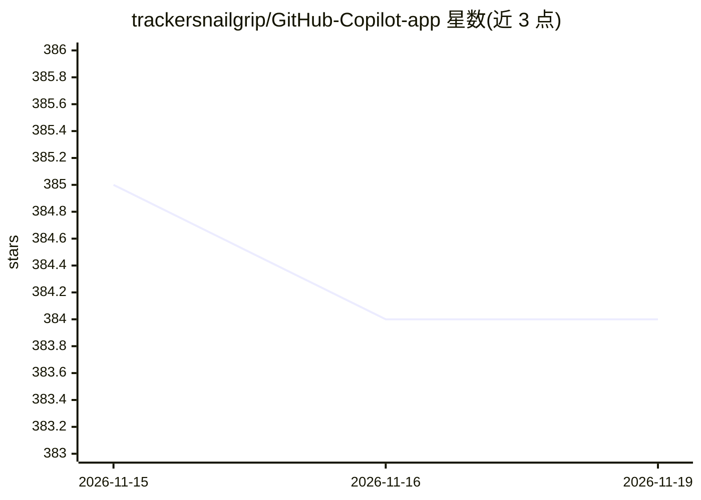

# trackersnailgrip/GitHub-Copilot-app

⭐ 384 · Apache-2.0 · 推送 2026-11-15 · [GitHub](https://github.com/trackersnailgrip/GitHub-Copilot-app) · 组织维护

**面向开发者的 GitHub Copilot 桌面端：查找、运行与管理编码 agent**

GitHub 官方仓库发布的桌面应用，用于在本地与云端管理 GitHub Copilot 编码 agent 的软件工作流：从发现待办工作、启动与引导 agent 会话、通过 Canvas 查看与编辑 agent 的工作过程，到经 Agent Merge 走完评审与合并。每个本地会话运行在独立 git worktree 中，云端会话运行在 GitHub 托管的隔离环境。需要 Git 与任意 Copilot 订阅，或自带 API key（BYOK）接入自选模型提供方。安装包从下载链接或 Releases 页获取，闭源且含使用数据遥测。

## 筛选速览

| 维度 | 判定 | 备注 |
|---|---|---|
| AI 角色 | `ai-ecosystem` | LLM/agent 周边工具 |
| 许可风险 | `permissive` | Apache-2.0 |
| 部署形态 | `desktop` | 安装包/桌面程序 |
| 模型依赖 | — | README 未给出锁定关系 |
| 硬件要求 | — | 无带数字的原话,不猜 |
| 安装摩擦 | `low` | 无编译、无系统依赖或容器化 |
| 成熟度 | — | 结构信号不足 |

## 能力要点

- 本地会话各自运行于独立 git worktree，云端会话运行于 GitHub 托管隔离环境
- Canvas 将 agent 的计划、终端、diff 与工作流状态呈现为可检查、可编辑的共享界面
- Automations 将可重复的提示与工作流转为定时或后台任务
- Agent Merge 辅助拉取请求走完评审、检查与合并流程

## 适用场景

- 并行运行多个 Copilot agent 分别处理 bug、issue 与评审反馈
- 把分散在终端、编辑器与浏览器标签页的 GitHub 工作集中到单一控制中心
- 以定时自动化任务执行重复性提示与工作流

## 场景标签

`编码 Agent` · 领域:编码与开发

## 证据(README 行号)

> L3: The GitHub Copilot app is an agent-native desktop experience for finding, running, steering, and landing software wo
> L13: The GitHub Copilot app is an agent-native desktop experience for managing software work from idea to pull request. 
> L76: © GitHub, Inc. All rights reserved.

## 星数曲线

2026-11-15 385 → 2026-11-19 384（-1）

---
*卡片 v1 · prompt 1.4 · 生成 2026-11-17 · 置信度 high · 依据 README sha `a85d674982eb` · [字段定义](../../DATASET.md)*
