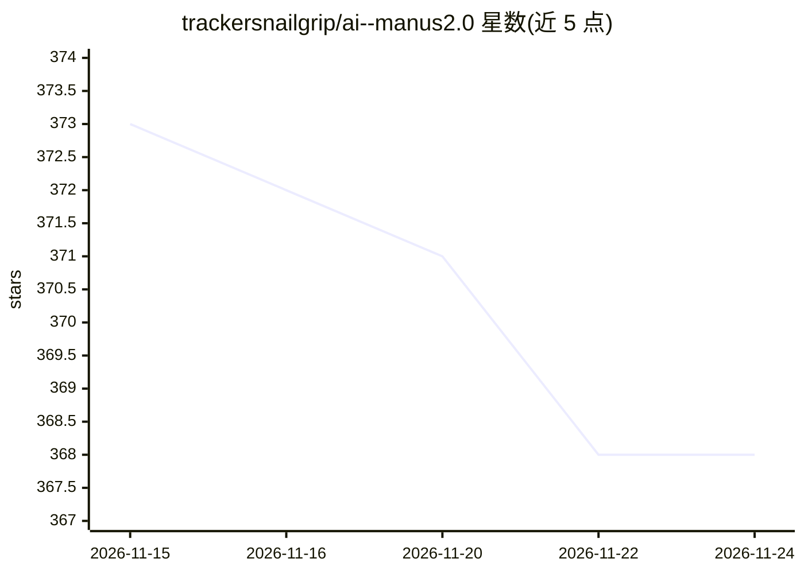

# trackersnailgrip/ai--manus2.0

⭐ 365 · Apache-2.0 · 推送 2026-11-15 · [GitHub](https://github.com/trackersnailgrip/ai--manus2.0) · 个人维护

**自主执行代码与控制浏览器的通用 AI Agent 系统**

README 描述的自主 AI Agent：用户以自然语言下达任务，agent 自行编写并执行脚本、打开网页、操作页面元素，完成多步骤任务，代码与浏览器动作可在同一流程中衔接。定位为面向家庭、学习与小规模工作的个人助手，而非企业平台。描述称其可在沙箱环境运行多种工具与操作，但 README 未给出具体安装命令、模型接入方式或代码入口，仅列出系统兼容性表与使用步骤指引。

## 筛选速览

| 维度 | 判定 | 备注 |
|---|---|---|
| AI 角色 | `ai-native` | 本体是模型或模型工具 |
| 许可风险 | `permissive` | Apache-2.0 |
| 部署形态 | `None` |  |
| 模型依赖 | — | README 未给出锁定关系 |
| 硬件要求 | — | 无带数字的原话,不猜 |
| 安装摩擦 | `low` | 无编译、无系统依赖或容器化 |
| 成熟度 | — | 结构信号不足 |

## 能力要点

- 自主编写并执行代码完成任务
- 浏览器控制：导航网页、填写表单、采集信息
- 代码执行与浏览器动作在同一工作流中衔接
- 面向家庭、学习与小规模任务的个人助手定位

## 适用场景

- 让 agent 代为完成重复性的网页操作与数据收集
- 学生整理研究笔记、运行小型脚本
- 小型项目中把重复步骤交给 agent，人工只做判断

## 场景标签

`AI 助手` `编码 Agent` `浏览器自动化` · 领域:效率与自动化

## 证据(README 行号)

> L10: - **Autonomous Code Execution:** Manus AI agent runs code on its own to complete tasks, so you can focus on decisio
> L18: Manus is an autonomous AI agent designed to run code and control a browser on your behalf. Instead of acting like a

## 星数曲线

2026-11-15 373 → 2026-11-24 368（-5）

---
*卡片 v1 · prompt 1.4 · 生成 2026-11-17 · 置信度 mid · 依据 README sha `67d67f5ffeb2` · [字段定义](../../DATASET.md)*
