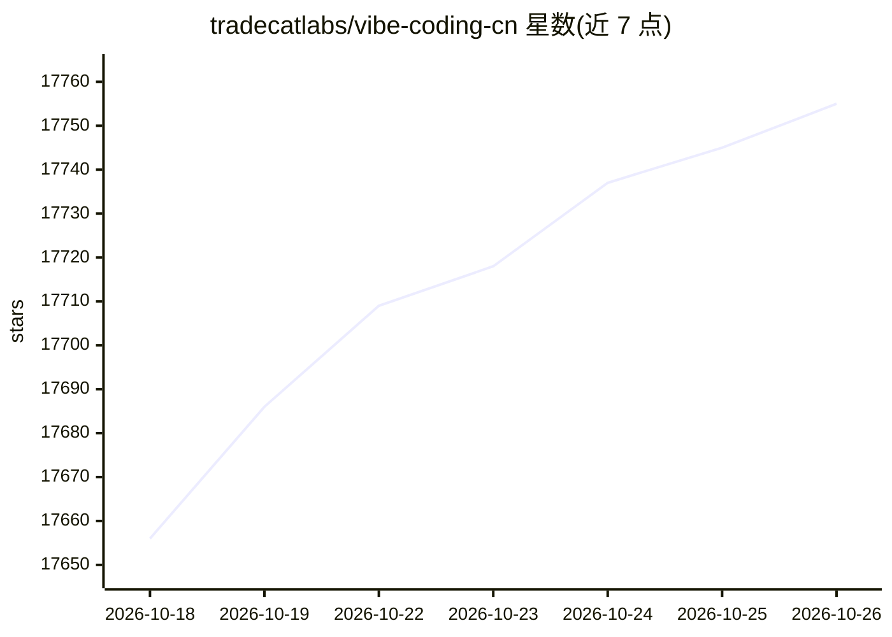

# tradecatlabs/vibe-coding-cn

⭐ — · [GitHub]() · 个人维护 · 中文 README

**中文 Vibe Coding 资源工具箱：整理提示词、Skills 与方法文集**

面向中文开发者的 Vibe Coding 资料仓库：以 Pi Agent 与 OpenAI GPT 为基座，将既有资产整理为 Context、Skills、Extensions 三个资源域，提供从零开始的入门路线、功法体系（思想/准则/方法文集）、法器体系（工具与依赖登记）、提示词在线表格等。使用需自备已授权的 Pi Agent 与 OpenAI GPT API，通过 git submodule 初始化来源后以 pi --skill 加载。仓库不保证模型效果，自动 CI 已停用，历史路线图仅为回溯。

## 筛选速览

| 维度 | 判定 | 备注 |
|---|---|---|
| AI 角色 | `ai-knowledge` | 知识聚合/清单类 |
| 许可风险 | `permissive` | — |
| 部署形态 | `None` |  |
| 模型依赖 | — | README 未给出锁定关系 |
| 硬件要求 | — | 无带数字的原话,不猜 |
| 安装摩擦 | `low` | 无编译、无系统依赖或容器化 |
| 成熟度 | — | 结构信号不足 |

## 动量与使用信号

- 维护:`active` — 距上次 push 1.5 天,年发版 0,3 位贡献者
- 涨星:近 1 天 **+51**(自 20261016 起算)
- 平台:— · 协议:MCP

## 能力要点

- Context/Skills/Extensions 三域整理既有资产，git submodule 锁定修订初始化
- 功法体系以 data.json 为唯一数据源生成天地玄黄四阶正文导航
- 从零开始入门路线覆盖 CLI 配置、第一个项目与 Git 闭环
- 性能指标（提示命中率、周转时间等）依赖人工在 progress.md 留痕

## 适用场景

- 新手按路线图入门 Vibe Coding 与 AI 结对编程
- 查找成体系的系统提示词与编程提示词脚本
- 了解 Vibe Coding 工作流中的工具角色与依赖类别

## 场景标签

`提示工程` `教程课程` `精选清单` · 领域:Agent 开发

## 证据(README 行号)

> L22: - `vibe-coding-cn` 是Vibe Coding工具箱，主体底座为Pi Agent与OpenAI GPT；本次只整理已有资产，不增加业务Skill。
> L25: - 资源统一为Context、Skills、Extensions；用现有测试、CI、脚本、类型、Schema与Git核对具体结果，不把分类当作运行或效果证明。
> L32: |Context|既有资料按需读取；功法、法器、入门、研究、提示词、资源、引用、索引及附件|

## 星数曲线

2026-10-18 17,656 → 2026-10-26 17,755（+99）

---
*卡片 v1 · prompt 1.4 · 生成 2026-10-20 · 置信度 high · 依据 README sha `85c341b2b7b2` · [字段定义](../../DATASET.md)*
