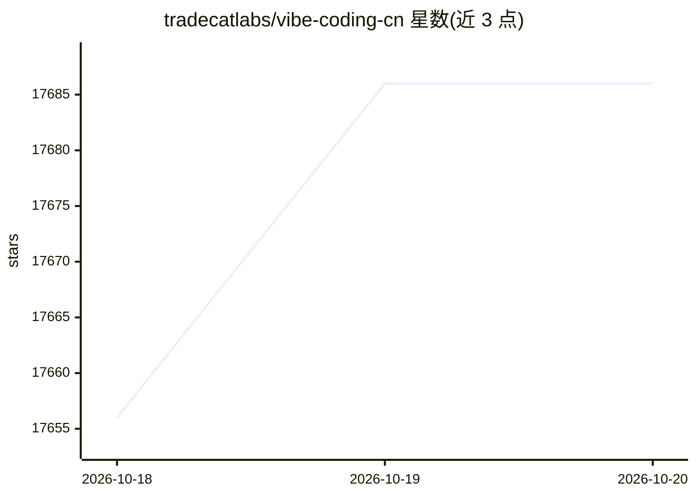

# tradecatlabs/vibe-coding-cn

⭐ 17,686 · Makefile · MIT · 推送 2026-10-19 · [GitHub](https://github.com/tradecatlabs/vibe-coding-cn) · [官网](https://tradecatlabs.com/) · 个人维护 · 中文 README

**面向中文开发者的 Vibe Coding 资源工具箱：整理提示词、Skill 与工作流资产**

以 Pi Agent 与 OpenAI GPT 为运行底座的 Vibe Coding 工具箱，将既有 Context、Skills、Extensions 组合为可验证的工作流。内容分为功法体系（思想、准则、方法与流程）、法器总表（30 项工具分级登记）、从零入门路线与 Codex 配置一键安装；交付路径为需求→上下文文档→实施计划→分步实现→自测→进度记录。仓库以 git submodule 锁定来源，Skill 通过 pi --skill 显式加载；README 声明只整理既有资产，未完成正式效能验证。

## 筛选速览

| 维度 | 判定 | 备注 |
|---|---|---|
| AI 角色 | `ai-knowledge` | 知识聚合/清单类 |
| 许可风险 | `permissive` | MIT |
| 部署形态 | `None` |  |
| 模型依赖 | — | README 未给出锁定关系 |
| 硬件要求 | — | 无带数字的原话,不猜 |
| 安装摩擦 | `low` | 无编译、无系统依赖或容器化 |
| 成熟度 | — | 结构信号不足 |

## 动量与使用信号

- 维护:`active` — 距上次 push 1.5 天,年发版 0,3 位贡献者
- 涨星:近 1 天 **+51**(自 20261016 起算)
- 平台:— · 协议:MCP

## 能力要点

- 功法体系：按问题选用思想、准则、思维模型与工程流程
- 法器总表：30 项工具按天/地/玄/黄四阶分级登记
- 从零入门路线覆盖网络环境、CLI 配置、首个项目与 Git 闭环
- 闭环交付路径：需求→上下文→计划→实现→自测→进度记录

## 适用场景

- 从零搭建 AI 结对编程的工作流与验收流程
- 按任务查找和复用现成的提示词与 Skill 资产
- 为团队建立可复盘、可移交的上下文管理规范

## 场景标签

`提示工程` `教程课程` `精选清单` · 领域:Agent 开发

## 证据(README 行号)

> L3: **以Pi Agent与OpenAI GPT为主体底座，将既有Context、Skills和Extensions组合成可验证的工作流。**
> L46: - `vibe-coding-cn` 是Vibe Coding工具箱，主体底座为Pi Agent与OpenAI GPT；本次只整理已有资产，不增加业务Skill。
> L109: 一句话：Vibe Coding = **规划驱动 + 上下文固定 + AI 结对执行**，让「从想法到可维护代码」变成一条可审计的流水线，而不是一团无法迭代的巨石文件。

## 星数曲线

2026-10-18 17,656 → 2026-10-20 17,686（+30）

---
*卡片 v1 · prompt 1.4 · 生成 2026-10-18 · 置信度 high · 依据 README sha `2c54ba70ae69` · [字段定义](../../DATASET.md)*
