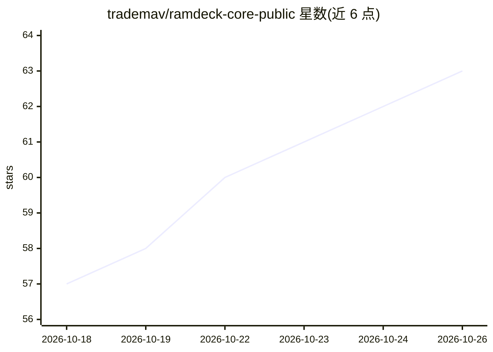

# trademav/ramdeck-core-public

⭐ 63 · Python · Apache-2.0 · 推送 2026-10-16 · [GitHub](https://github.com/trademav/ramdeck-core-public) · [官网](https://ramdeck.com) · 组织维护

**把多台旧设备的 RAM 池化，分布式跑更大 LLM 的节点引擎**

RAMDeck 的核心节点引擎公开参考快照：在 Mac/Windows/Android 设备上运行节点代理，将 LLM 推理分片到异构硬件，通过标准 llama.cpp RPC 协议（端口 50052/50053）对外提供 tensor offload，任意兼容协调器或第三方 UI 可接入，节点经 HTTP POST 向协调器注册并发送心跳。v0.9 pre-1.0，无内置 GUI，Linux 节点不支持，Windows 需用官网安装包；源码可用但采用 Apache 2.0 加 Commons Clause 限制的商业许可，非 OSI 开源。

## 筛选速览

| 维度 | 判定 | 备注 |
|---|---|---|
| AI 角色 | `ai-ecosystem` | LLM/agent 周边工具 |
| 许可风险 | `permissive` | Apache-2.0 |
| 部署形态 | `library` | 以包/库形式分发 |
| 模型依赖 | local-ok | 支持本地模型 |
| 硬件要求 | — | 无带数字的原话,不猜 |
| 安装摩擦 | `low` | 无编译、无系统依赖或容器化 |
| 成熟度 | `idea` | |

## 能力要点

- 节点代理跨 Mac/Windows/Android 运行，池化异构设备内存
- 实现 ggml-rpc-server，兼容标准 llama.cpp RPC 协议
- 可用 llama-cli 从主机远程推理验证分布式 offload
- 附带 TinyStories-15M 快速自检脚本与 mock coordinator 示例

## 适用场景

- 把家里闲置的旧电脑/手机组成内存池运行更大的本地模型
- homelab 中搭建自托管分布式 LLM 推理集群
- 在 RAM 价格高企时用现有设备替代购置大内存单机

## 场景标签

`推理引擎` · 领域:训练与推理

## 证据(README 行号)

> L7: This repository contains the core node-agent and distributed orchestration plumbing for RAMDeck. It is the exact eng
> L42: The node agent runs a `ggml-rpc-server` on port 50052 (GPU) and 50053 (CPU).

## 星数曲线

2026-10-18 57 → 2026-10-26 63（+6）

---
*卡片 v1 · prompt 1.4 · 生成 2026-10-24 · 置信度 high · 依据 README sha `22c1a6aae552` · [字段定义](../../DATASET.md)*
