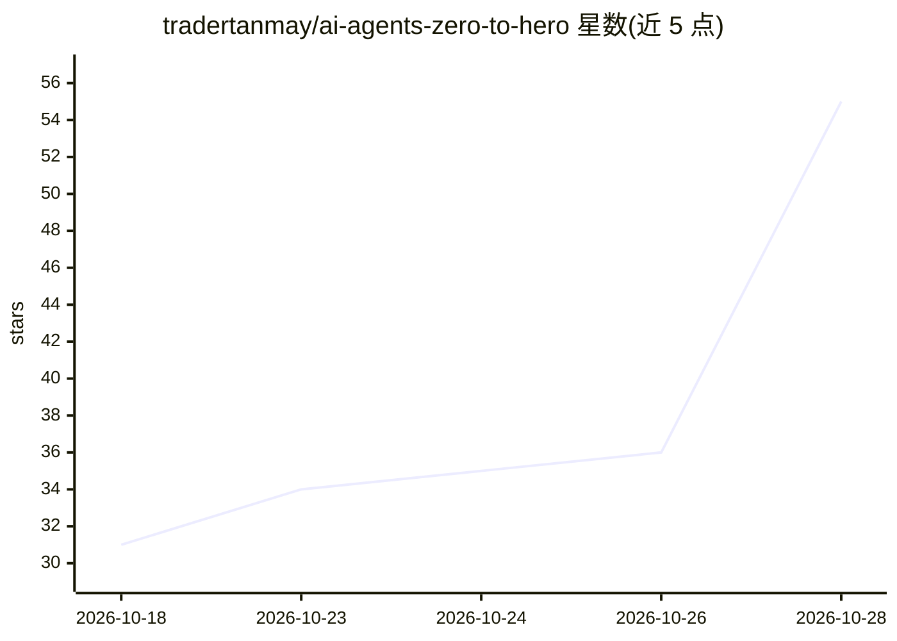

# tradertanmay/ai-agents-zero-to-hero

⭐ 55 · Python · NOASSERTION · 推送 2026-10-14 · [GitHub](https://github.com/tradertanmay/ai-agents-zero-to-hero) · 个人维护

**零依赖的 AI agent 从原理到生产教学课程库**

由个人维护的源码可获取教学仓库，以纯 Python 3.11+ 标准库从第一性原理讲授 AI agent：16 个递进模块覆盖 agent 循环、工具调用与 MCP、状态与记忆、运行时 Harness、多智能体、失败分析、评测、安全与生产化，另含 5 个应用型 agent 系统。所有课程使用确定性模拟器与 mock LLM，无需 API key 即可离线运行，也支持接入 OpenAI/Anthropic/Gemini/Ollama 真实模型。以 git clone 源码方式获取，配套框架映射说明（LangGraph/AutoGen 等）。

## 筛选速览

| 维度 | 判定 | 备注 |
|---|---|---|
| AI 角色 | `ai-knowledge` | 知识聚合/清单类 |
| 许可风险 | `none` | NOASSERTION |
| 部署形态 | `None` |  |
| 模型依赖 | local-ok | 支持本地模型 |
| 硬件要求 | — | 无带数字的原话,不猜 |
| 安装摩擦 | `low` | 无编译、无系统依赖或容器化 |
| 成熟度 | — | 结构信号不足 |

## 能力要点

- 16 个递进模块，从入门到 Level 5 研究（含评测、安全、生产化）
- 零强制依赖、零 API key，全部课程可离线运行
- 可插拔真实模型提供商（OpenAI/Anthropic/Gemini/本地 Ollama）
- 附 5 个应用型 agent 系统（Reddit 审核/持久化/研究/浏览器/编码）

## 适用场景

- 系统学习 AI agent 的内部机制，摆脱框架黑盒
- 在无 API key 的离线环境跑通完整 agent 循环
- 理解 LangGraph、AutoGen、OpenAI Agents SDK 等框架的职责划分

## 场景标签

`教程课程` · 领域:学习与行业

## 证据(README 行号)

> L53: ## What This Repository Is
> L169: |Module|Level|Status|What You Will Learn|

## 星数曲线

2026-10-18 31 → 2026-10-28 55（+24）

---
*卡片 v1 · prompt 1.4 · 生成 2026-10-25 · 置信度 high · 依据 README sha `38558ba55695` · [字段定义](../../DATASET.md)*
