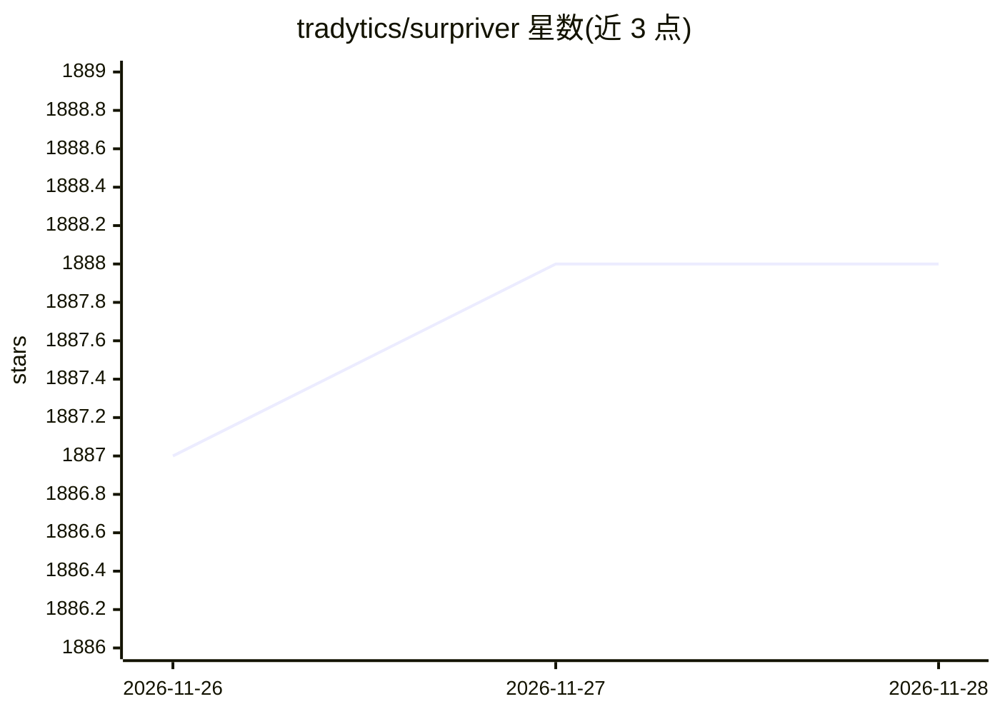

# tradytics/surpriver

⭐ 1,888 · Python · GPL-3.0 · 推送 2026-11-24 · [GitHub](https://github.com/tradytics/surpriver) · [官网](https://www.tradytics.com/) · 组织维护

**用异常检测在股价大波动前筛出异动股票的工具**

基于 Python 的股票异常检测工具：从 Yahoo Finance 或 Binance 下载量价数据，生成收益率与技术指标特征，用异常检测模型对每只股票计算异常分数，输出分数最低（越异常）的 top N 股票清单，支持 CLI 或 JSON 输出。用户可编辑股票清单、设置K线粒度与最小成交量，并可用 is_test/future_bars 参数在历史数据上回测预测效果。限制：只找异常行为，不预测涨跌方向。

## 筛选速览

| 维度 | 判定 | 备注 |
|---|---|---|
| AI 角色 | `ai-native` | 本体是模型或模型工具 |
| 许可风险 | `viral` | GPL-3.0 |
| 部署形态 | `self-host` | docker 或自建部署 |
| 模型依赖 | — | README 未给出锁定关系 |
| 硬件要求 | — | 无带数字的原话,不猜 |
| 安装摩擦 | `low` | 无编译、无系统依赖或容器化 |
| 成熟度 | — | 结构信号不足 |

## 能力要点

- 对量价与技术指标特征计算异常分数并排名
- 支持 1min–60min 多种K线粒度与成交量过滤
- 提供历史回测模式，输出相关性等统计结果
- 数据源可选 Yahoo Finance 与 Binance（加密货币）

## 适用场景

- 每日扫描自选股票池找出异常量价模式的标的
- 在历史数据上回测异常分数与后续涨跌的关系
- 将加密货币加入扫描范围

## 场景标签

`金融量化` · 领域:学习与行业

## 证据(README 行号)

> L2: Find high moving stocks before they move using anomaly detection and machine learning. Surpriver uses machine learni
> L17: | detection_engine.py | Main module for running anomaly detection on data and finding stocks with most unusual pric

## 星数曲线

2026-11-26 1,887 → 2026-11-28 1,888（+1）

---
*卡片 v1 · prompt 1.4 · 生成 2026-11-26 · 置信度 mid · 依据 README sha `1858d4173ed4` · [字段定义](../../DATASET.md)*
