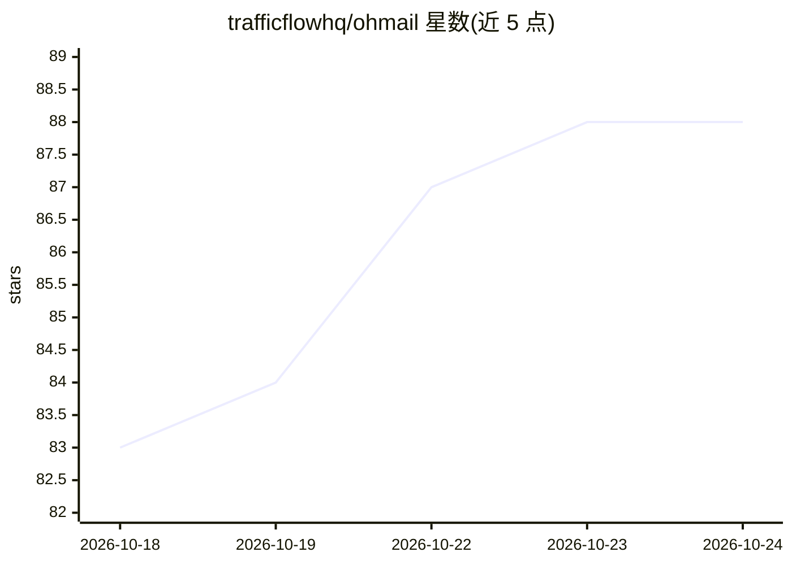

# trafficflowhq/ohmail

⭐ 88 · TypeScript · AGPL-3.0 · 推送 2026-10-23 · [GitHub](https://github.com/trafficflowhq/ohmail) · [官网](https://ohmail.app) · 组织维护

**连接现有 IMAP 邮箱的同意优先邮件客户端，带可选 AI 筛选**

运行在用户自有 IMAP 邮箱上的邮件客户端，提供 macOS/Windows/Linux 桌面版及服务端源码（AGPL-3.0，无账号）。核心机制：新发件人停留在 Screener 等待用户放行，已同意的邮件归入 Ohbox 并以真实 IMAP 文件夹保存，可被其他邮件应用读取；设置以版本化 JSON 存于邮箱内。AI 部分可选：用户自己的 Anthropic/OpenAI/OpenCode Go key 或经 Ollama 的本地模型，为等待中的发件人提出归档建议（含置信度与理由），默认关闭，验证码在送入模型前被剥离。另含全文容错搜索、附件压缩、设备托管（Tailscale）等。Android/iOS 应用未发布。

## 筛选速览

| 维度 | 判定 | 备注 |
|---|---|---|
| AI 角色 | `ai-enhanced` | 去掉 AI 部分产品仍成立 |
| 许可风险 | `viral` | AGPL-3.0 |
| 部署形态 | `desktop` | 安装包/桌面程序 |
| 模型依赖 | local-ok | 支持本地模型 |
| 硬件要求 | — | 无带数字的原话,不猜 |
| 安装摩擦 | `low` | 无编译、无系统依赖或容器化 |
| 成熟度 | — | 结构信号不足 |

## 能力要点

- 新发件人停留在 Screener，由用户决定放行；规则以真实 IMAP 文件夹保存
- AI 筛选可选：自有 API key 或经 Ollama 的本地模型，默认关闭
- 设置以版本化 JSON 存于邮箱 ohmail/_meta 文件夹，随邮箱迁移
- 桌面安装可作为其他设备的服务端（Tailscale 隧道，无云端路径）

## 适用场景

- 在现有 Gmail/M365/自建 IMAP 邮箱上做发件人许可式收件
- 用本地或自有云端模型辅助筛选新发件人
- 自托管邮件客户端并在多设备间共享同一邮箱组织结果

## 场景标签

 · 领域:邮件/通信工具

## 证据(README 行号)

> L52: With AI on — your own Anthropic, OpenAI or OpenCode Go key, or a local model
> L53: through Ollama, and off until you turn it on — the Screener
> L68: Configure nothing and the Screener still holds first contact, rules still file

## 星数曲线

2026-10-18 83 → 2026-10-24 88（+5）

---
*卡片 v1 · prompt 1.4 · 生成 2026-10-23 · 置信度 high · 依据 README sha `e60e4f0d87ac` · [字段定义](../../DATASET.md)*
