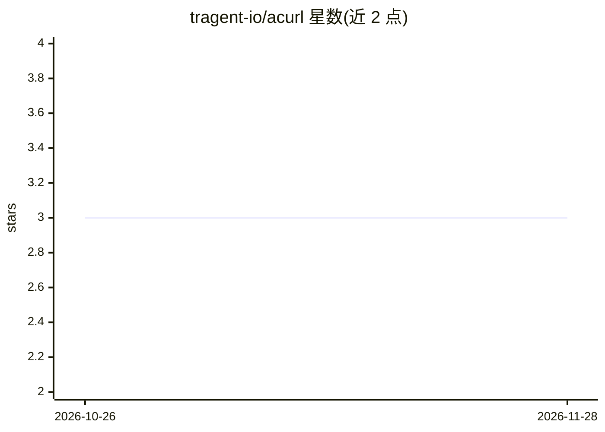

# tragent-io/acurl

⭐ 3 · Go · Apache-2.0 · 推送 2026-11-02 · [GitHub](https://github.com/tragent-io/acurl) · [官网](https://acurl.dev) · 组织维护

**AI agent HTTP 可达性检测 CLI：模拟 21 种 agent UA 测试站点响应**

Go 编写的命令行工具：对同一 URL 以真实 Chrome 浏览器指纹与 21 种 AI agent/爬虫 profile（ChatGPT-User、Claude-User、GPTBot、PerplexityBot 等）发起 HTTP 请求，比较状态码、WAF 挑战、robots.txt 规则、可见文本相似度与商品数据差异，并输出 0-100 的 AI readiness 分数。输出支持表格、JSON、SARIF、JUnit、Markdown 等格式，退出码可按 --fail-on 策略用于脚本与 CI。提供 Homebrew、Shell、Go、npm、Docker、二进制六种安装方式，另含 MCP server 与 AI CLI 流量监听子命令。README 声明其结果仅反映站点对 agent UA 的响应，不能保证真实 agent 可访问。

## 筛选速览

| 维度 | 判定 | 备注 |
|---|---|---|
| AI 角色 | `ai-ecosystem` | LLM/agent 周边工具 |
| 许可风险 | `permissive` | Apache-2.0 |
| 部署形态 | `self-host` | docker 或自建部署 |
| 模型依赖 | — | README 未给出锁定关系 |
| 硬件要求 | — | 无带数字的原话,不猜 |
| 安装摩擦 | `low` | 无编译、无系统依赖或容器化 |
| 成熟度 | — | 结构信号不足 |

## 能力要点

- 以 Chrome TLS/HTTP2 指纹为基线，对比 21 种 agent/crawler profile 的响应差异
- 检测 Cloudflare、Akamai、DataDome 等 WAF 挑战与 cloaking（可见文本差异）
- 输出 AI readiness 分数（0-100），每项失败附带修复建议
- acurl mcp 提供 MCP server，供 Claude/Cursor 等助手调用检测

## 适用场景

- 检查产品页是否对 AI 助手/搜索爬虫返回与浏览器不同的内容
- 在 CI 中批量检测站点是否被 WAF 拦截 agent 请求
- 让 Claude 或 Cursor 通过 MCP 查询页面能否被 ChatGPT 读取
- 监听 Claude Code/Codex/Gemini CLI 发出的 API 流量

## 场景标签

 · 领域:开发者工具/Web 可达性检测

## 证据(README 行号)

> L13: **acurl** sends one HTTP request as a real Chrome browser and as 21 AI agent and crawler
> L63: |`acurl mcp`|MCP server so Claude, Cursor and other assistants can run checks|
> L17: `--fail-on` policy, so it drops into scripts and CI.

## 星数曲线

2026-10-26 3 → 2026-11-28 3（+0）

---
*卡片 v1 · prompt 1.4 · 生成 2026-11-21 · 置信度 high · 依据 README sha `87794921c02e` · [字段定义](../../DATASET.md)*
