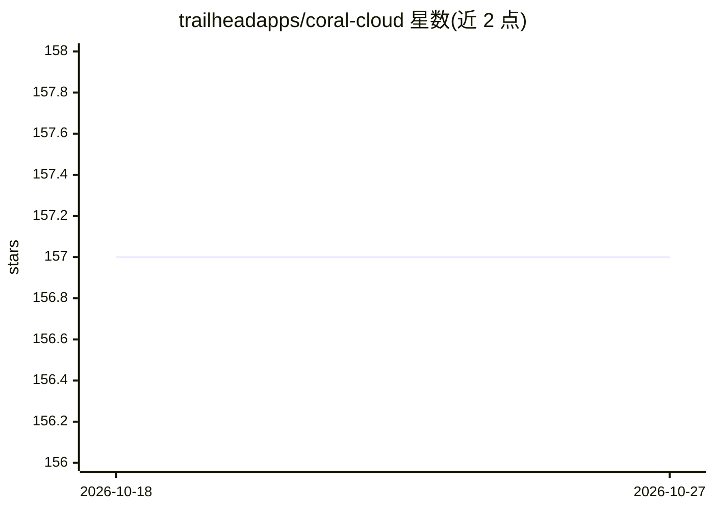

# trailheadapps/coral-cloud

⭐ 157 · HTML · CC0-1.0 · 推送 2026-10-26 · [GitHub](https://github.com/trailheadapps/coral-cloud) · 组织维护

**Salesforce 示例应用：演示 Data Cloud、Agentforce 与 Prompts**

虚构酒店 Coral Cloud Resorts 的示例应用，由 Salesforce Trailhead 团队维护，用于演示 Data Cloud、Agentforce Agents 与 Prompt Builder 在业务流程中的用法，包括智能自动化、内容生成与摘要。安装要求具备 Data Cloud、Agents 与 Prompt Builder 许可的 Salesforce org，通过 Salesforce CLI 部署元数据、导入示例数据并安装 Data Kit。供开发者在自己的 org 中部署学习。

## 筛选速览

| 维度 | 判定 | 备注 |
|---|---|---|
| AI 角色 | `ai-knowledge` | 知识聚合/清单类 |
| 许可风险 | `viral` | CC0-1.0 |
| 部署形态 | `library` | 以包/库形式分发 |
| 模型依赖 | — | README 未给出锁定关系 |
| 硬件要求 | — | 无带数字的原话,不猜 |
| 安装摩擦 | `medium` | 含编译或系统依赖之一 |
| 成熟度 | — | 结构信号不足 |

## 能力要点

- 演示 Agentforce agents 接入业务流程
- 含 Prompt Builder 字段生成模板与 Data Cloud 组件
- 通过 Salesforce CLI 脚本化部署（元数据、权限集、示例数据、Data Kit）

## 适用场景

- 学习如何在 Salesforce 平台构建 AI agent 业务流程
- 了解 Data Cloud 与 Prompts 的集成方式
- 作为二次开发或教学演示的起点

## 场景标签

`教程课程` · 领域:学习与行业

## 证据(README 行号)

> L7: Welcome to Coral Cloud Resorts, a sample hospitality application. Coral Cloud Resorts is a fictional resort that use
> L9: The Coral Cloud Resorts app showcases **Data Cloud**, **Agents** and **Prompts**.

## 星数曲线

2026-10-18 157 → 2026-10-27 157（+0）

---
*卡片 v1 · prompt 1.4 · 生成 2026-10-22 · 置信度 low · 依据 README sha `b05b29d4b981` · [字段定义](../../DATASET.md)*
