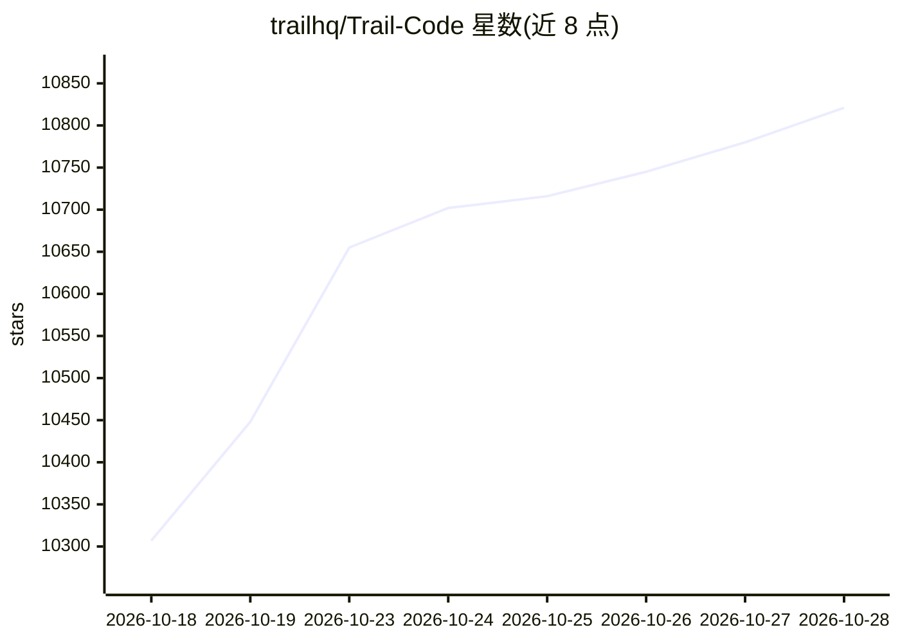

# trailhq/Trail-Code

⭐ 10,859 · TypeScript · MIT · 推送 2026-10-28 · [GitHub](https://github.com/trailhq/Trail-Code) · [官网](https://trailhq.com/graft) · 组织维护

**给编码 agent 的代码地图与团队经验学习层**

面向 Claude Code、Cursor、Codex 等编码 agent 的上下文层，含两部分：graft map 用 tree-sitter 把仓库解析为文件/函数/调用关系图（无模型、无 API key，支持 23 种语言），通过 hooks/MCP 把相关代码随每次提示注入；learnings 从对话中保存团队决策与偏好为 markdown 文件，随 git 提交，`trail check` 在 PR 前比对照已学内容并提示冲突。本地运行，无 daemon/server，npm 全局安装。

## 筛选速览

| 维度 | 判定 | 备注 |
|---|---|---|
| AI 角色 | `ai-ecosystem` | LLM/agent 周边工具 |
| 许可风险 | `permissive` | MIT |
| 部署形态 | `self-host` | docker 或自建部署 |
| 模型依赖 | — | README 未给出锁定关系 |
| 硬件要求 | — | 无带数字的原话,不猜 |
| 安装摩擦 | `low` | 无编译、无系统依赖或容器化 |
| 成熟度 | — | 结构信号不足 |

## 能力要点

- tree-sitter 解析代码为函数/调用图，确定性构建，无需模型或 API key
- learnings 以 markdown 文件保存在 .trail/，随 git 提交共享给团队
- trail check 在 PR 前比变更与团队决策并检测与同事分支的冲突
- 通过 Claude Code hooks 与 MCP 工具接入多种编码 agent

## 适用场景

- 让编码 agent 少做盲目检索，直接定位相关文件与函数
- 把团队对代码的决策和偏好沉淀下来供后续会话与同事使用
- PR 前自动核验变更是否违背团队已有决策

## 场景标签

`Agent 记忆` · 领域:Agent 开发

## 证据(README 行号)

> L3: ### The self-learning context layer for coding agents.
> L54: 1. **The graft map: your code.** `trail init` parses your repo with tree-sitter into a map of every file, function 
> L103: - **The right code with every prompt.** In Claude Code, hooks add the matching files and functions to each prompt,

## 星数曲线

2026-10-18 10,307 → 2026-10-28 10,821（+514）

---
*卡片 v1 · prompt 1.4 · 生成 2026-10-20 · 置信度 mid · 依据 README sha `dd8441417ec0` · [字段定义](../../DATASET.md)*
