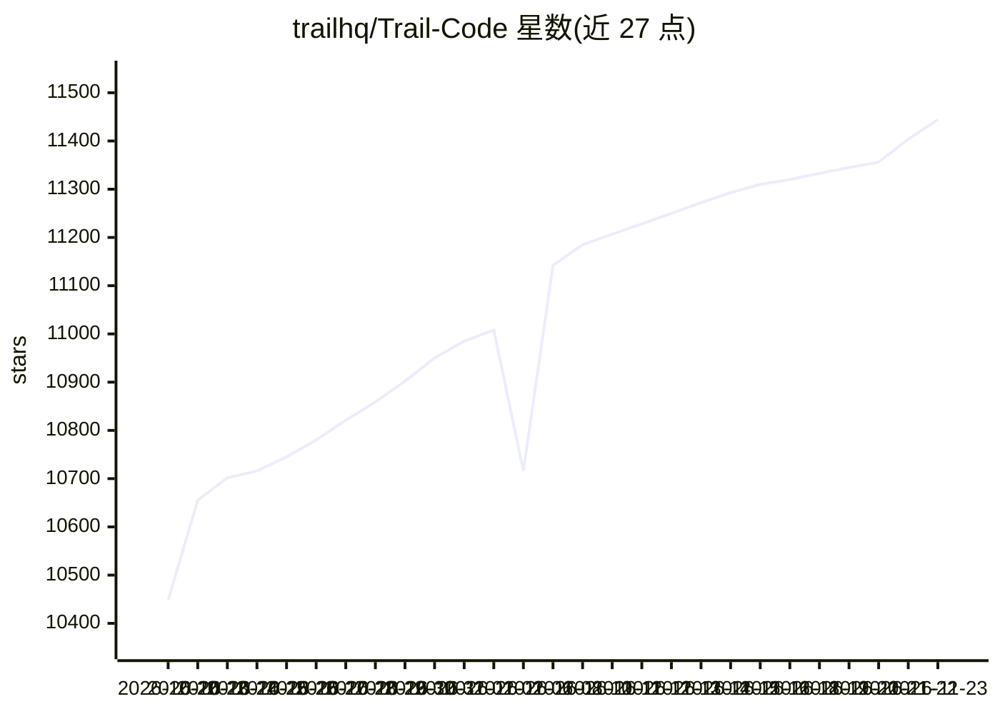

# trailhq/Trail-Code

⭐ 11,444 · TypeScript · MIT · 推送 2026-11-22 · [GitHub](https://github.com/trailhq/Trail-Code) · [官网](https://trailhq.com/trail-code) · 组织维护

**为团队编码 agent 提供共享代码地图与决策记忆的 CLI**

由 npm CLI 安装的本地工具，面向使用 Claude Code、Cursor、Codex 等编码 agent 的开发团队。两部分机制：graft map 用 tree-sitter 在本机解析仓库生成函数/调用者图谱，24 种语言，无需模型与 API key，经 hooks 或 MCP 注入 agent 提示；learnings 从会话中自动保存团队决策，存为可读的 markdown 文件并随代码提交。支持个人/仓库/团队三级存放，trail check 在 PR 前比对学习记录。Node 22.3+ 或 20.16。

## 筛选速览

| 维度 | 判定 | 备注 |
|---|---|---|
| AI 角色 | `ai-ecosystem` | LLM/agent 周边工具 |
| 许可风险 | `permissive` | MIT |
| 部署形态 | `self-host` | docker 或自建部署 |
| 模型依赖 | — | README 未给出锁定关系 |
| 硬件要求 | — | 无带数字的原话,不猜 |
| 安装摩擦 | `low` | 无编译、无系统依赖或容器化 |
| 成熟度 | — | 结构信号不足 |

## 能力要点

- tree-sitter 解析 24 种语言生成代码调用图谱，无模型、无网络
- learnings 从会话自动沉淀，随代码提交供团队共享
- 通过 Claude Code hooks、MCP 工具接入多种编码 agent
- trail check 在 PR 前标记与既有团队决策冲突的改动

## 适用场景

- 让新会话的 agent 直接接手团队之前的工作上下文
- 减少编码 agent 重复探索代码库的 token 与时间开销
- 团队把代码决策沉淀为文件并随代码提交共享

## 场景标签

`编码 Agent` · 领域:编码与开发

## 证据(README 行号)

> L3: ### The self-learning context layer for coding agents.
> L54: 1. **The graft map: your code.** `trail init` parses your repo with tree-sitter into a map of every file, function 
> L108: - **The right code with every prompt.** In Claude Code, hooks add the matching files and functions to each prompt,

## 星数曲线

2026-10-20 10,448 → 2026-11-23 11,444（+996）

---
*卡片 v1 · prompt 1.4 · 生成 2026-11-22 · 置信度 mid · 依据 README sha `5a68ea0b0dbf` · [字段定义](../../DATASET.md)*
