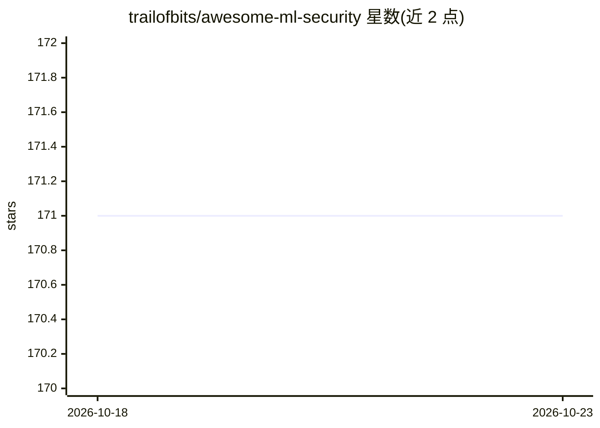

# trailofbits/awesome-ml-security

⭐ 171 · CC-BY-4.0 · 推送 2026-02-06 · [GitHub](https://github.com/trailofbits/awesome-ml-security) · 组织维护

**机器学习安全参考资源策展清单：文献/工具/标准/事件汇总**

Trail of Bits 维护的机器学习安全主题聚合清单，按 CIA（机密性/完整性/可用性）、模型性能退化、ML-Ops、AI 对安全的影响、监管动向（美/欧）、安全标准（ISO/IEC、NIST、OWASP）、分类框架、安全工具（PrivacyRaven、Fickling、Garak 等）、背景学习资料、深度伪造与滥用、知名安全事件与危害等板块组织，收录论文、审计报告、工具与事件表格，供安全研究与工程人员查阅，不提供可运行软件。

## 筛选速览

| 维度 | 判定 | 备注 |
|---|---|---|
| AI 角色 | `ai-knowledge` | 知识聚合/清单类 |
| 许可风险 | `viral` | CC-BY-4.0 |
| 部署形态 | `None` |  |
| 模型依赖 | — | README 未给出锁定关系 |
| 硬件要求 | — | 无带数字的原话,不猜 |
| 安装摩擦 | `low` | 无编译、无系统依赖或容器化 |
| 成熟度 | — | 结构信号不足 |

## 能力要点

- 按模型 CIA 三性与 ML-Ops 分类收录攻击/防御文献
- 收录 ISO/IEC、NIST、MITRE ATLAS、OWASP 等安全标准与框架
- 列出 PrivacyRaven、Fickling、Counterfit、Garak 等安全工具
- 以表格形式汇总知名 ML 安全事件与算法危害案例

## 适用场景

- 查找 ML 隐私攻击、后门、提示注入等方向的文献与工具
- 了解 AI 安全相关的监管文件与安全标准
- 检索历史上的 ML 安全事件与危害案例作研究参考

## 场景标签

 · 领域:AI 安全/知识聚合

## 证据(README 行号)

> L3: A curated list of awesome machine learning security references, guidance, tools, and more.
> L125: ## Security tools and techniques

## 星数曲线

2026-10-18 171 → 2026-10-23 171（+0）

---
*卡片 v1 · prompt 1.4 · 生成 2026-10-22 · 置信度 high · 依据 README sha `e2d5c9a5f9f6` · [字段定义](../../DATASET.md)*
