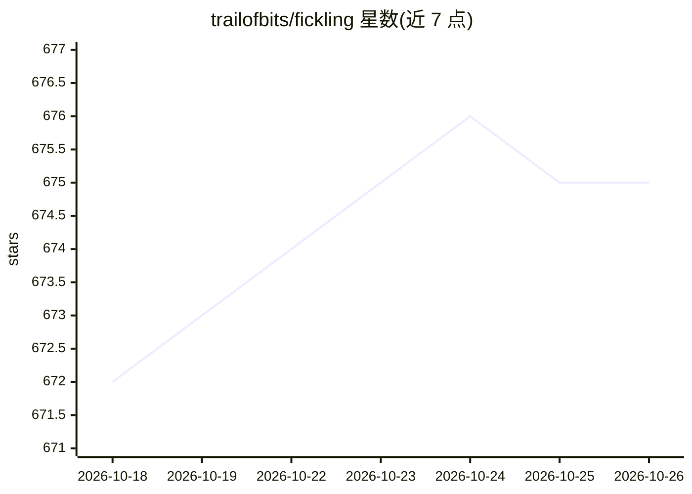

# trailofbits/fickling

⭐ 675 · Python · LGPL-3.0 · 推送 2026-10-23 · [GitHub](https://github.com/trailofbits/fickling) · 组织维护

**Python pickle 反编译与静态分析工具，检测恶意模型文件**

针对 Python pickle 序列化格式的反编译器、静态分析器与字节码重写器，以 Python 库和 CLI 两种形式提供。可将 pickle 文件反编译为可读 Python 代码、符号执行 Pickle 虚拟机以安全分析潜在恶意文件、支持 PyTorch 各版本模型文件格式的检查与 polyglot 文件的识别和构造。面向 ML 场景提供安全钩子：激活后对 pickle 模块全局挂钩，加载模型时按 ML 库导入白名单校验并阻断非白名单导入；另支持运行时安全检查（上下文管理器、单文件检查）与代码注入等高级用法。

## 筛选速览

| 维度 | 判定 | 备注 |
|---|---|---|
| AI 角色 | `ai-enhanced` | 去掉 AI 部分产品仍成立 |
| 许可风险 | `viral` | LGPL-3.0 |
| 部署形态 | `library` | 以包/库形式分发 |
| 模型依赖 | — | README 未给出锁定关系 |
| 硬件要求 | — | 无带数字的原话,不猜 |
| 安装摩擦 | `low` | 无编译、无系统依赖或容器化 |
| 成熟度 | — | 结构信号不足 |

## 能力要点

- 将 pickle 反编译为可读 Python 代码，PM 符号执行避免实际运行恶意代码
- hook.activate_safe_ml_environment() 按 ML 库导入白名单阻断恶意模型加载
- 支持 PyTorch v0.1.1–v1.3 及 TorchScript 等多种文件格式的识别、检查与 polyglot 构造
- CLI 提供 --check-safety、--trace、--inject 等命令，非 Python 环境也可做安全检查

## 适用场景

- 加载 PyTorch 等模型文件前扫描其中的恶意 pickle 代码
- 对来源不明的 pickle 文件做反编译与逆向分析
- 在 ML 训练/推理代码库中接入运行时安全钩子阻断恶意文件加载

## 场景标签

`网络安全` · 领域:学习与行业

## 证据(README 行号)

> L5: Fickling is a decompiler, static analyzer, and bytecode rewriter for Python
> L40: Fickling can help securing AI/ML codebases by automatically scanning pickle files contained in
> L44: Add the following lines as early as possible, **before importing `torch`, `numpy`, or any other

## 星数曲线

2026-10-18 672 → 2026-10-26 675（+3）

---
*卡片 v1 · prompt 1.4 · 生成 2026-10-21 · 置信度 high · 依据 README sha `a538f3863305` · [字段定义](../../DATASET.md)*
