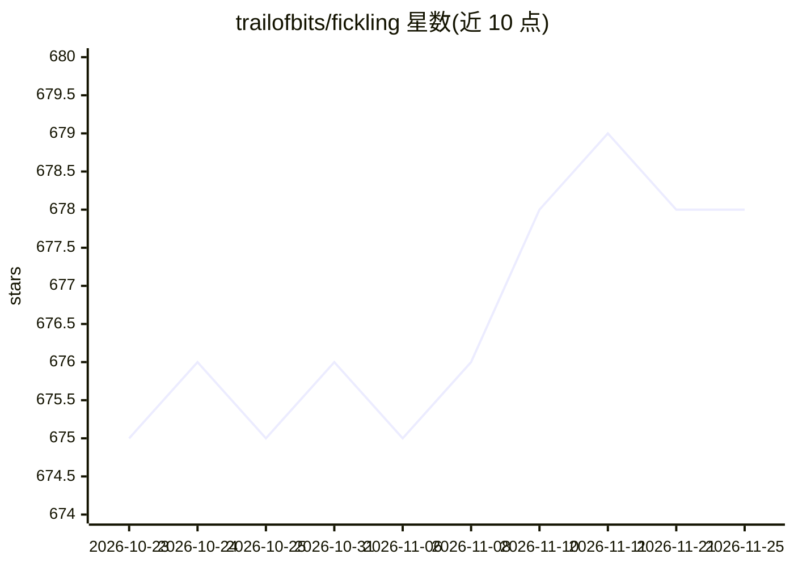

# trailofbits/fickling

⭐ 678 · Python · LGPL-3.0 · 推送 2026-11-19 · [GitHub](https://github.com/trailofbits/fickling) · 组织维护

**给开发者的 Python pickle 反编译与静态安全分析工具**

面向 Python pickle 序列化格式的反编译器、静态分析器与字节码重写器，可作为库或 CLI 使用。可检测、分析、逆向或构造恶意 pickle 文件；通过钩子 pickle 模块对导入做白名单校验，在加载 PyTorch 等模型时拦截非白名单导入并抛出 UnsafeFileError；还支持在不执行代码的情况下符号执行追踪 pickle 字节码，以及创建 PyTorch 多格式 polyglot 文件。要求 Python 3.11+，依赖极少。

## 筛选速览

| 维度 | 判定 | 备注 |
|---|---|---|
| AI 角色 | `ai-enhanced` | 去掉 AI 部分产品仍成立 |
| 许可风险 | `viral` | LGPL-3.0 |
| 部署形态 | `library` | 以包/库形式分发 |
| 模型依赖 | — | README 未给出锁定关系 |
| 硬件要求 | — | 无带数字的原话,不猜 |
| 安装摩擦 | `low` | 无编译、无系统依赖或容器化 |
| 成熟度 | — | 结构信号不足 |

## 能力要点

- 将 pickle 字节码反编译为可读 Python 代码，采用符号执行避免执行恶意代码
- 钩子 pickle 模块按 ML 库导入白名单拦截不安全加载
- 支持识别、检查与构造 8 类 PyTorch 文件格式的 polyglot
- 提供 always_check_safety / 上下文管理器 / 单文件检查等多种集成方式

## 适用场景

- 在加载来源不明的 PyTorch/pickle 模型前检查是否含恶意代码
- 在 ML 代码库运行时强制 pickle 反序列化安全检查
- 逆向分析 pickle 文件的字节码与导入行为

## 场景标签

`网络安全` · 领域:学习与行业

## 证据(README 行号)

> L5: Fickling is a decompiler, static analyzer, and bytecode rewriter for Python
> L7: You can use fickling to detect, analyze, reverse engineer, or even create
> L40: Fickling can help securing AI/ML codebases by automatically scanning pickle files contained in

## 星数曲线

2026-10-23 675 → 2026-11-25 678（+3）

---
*卡片 v1 · prompt 1.4 · 生成 2026-11-24 · 置信度 high · 依据 README sha `8a1d690268d7` · [字段定义](../../DATASET.md)*
