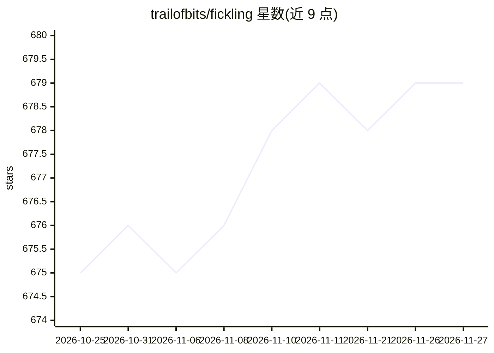

# trailofbits/fickling

⭐ 679 · Python · LGPL-3.0 · 推送 2026-11-26 · [GitHub](https://github.com/trailofbits/fickling) · 组织维护

**给 AI/ML 开发者的 pickle 反编译与恶意文件检测工具**

Trail of Bits 开发的 Python pickle 序列化反编译器、静态分析器与字节码重写工具，提供库与 CLI 两种形态。可检测、分析、逆向工程或构造恶意 pickle 及 PyTorch 文件；通过挂钩 pickle 模块并对照 ML 库安全导入白名单，在模型加载前拦截含其他导入的文件；符号执行 Pickle 虚拟机字节码，不实际运行可疑代码。需要 Python 3.11+，PyTorch 为可选依赖。

## 筛选速览

| 维度 | 判定 | 备注 |
|---|---|---|
| AI 角色 | `ai-ecosystem` | LLM/agent 周边工具 |
| 许可风险 | `viral` | LGPL-3.0 |
| 部署形态 | `library` | 以包/库形式分发 |
| 模型依赖 | — | README 未给出锁定关系 |
| 硬件要求 | — | 无带数字的原话,不猜 |
| 安装摩擦 | `low` | 无编译、无系统依赖或容器化 |
| 成熟度 | — | 结构信号不足 |

## 能力要点

- 反编译 pickle 字节码为可读 Python 代码（自定义 PM 实现，符号执行）
- 挂钩 pickle 模块，按 ML 库导入白名单拦截恶意文件
- 支持 8 种 PyTorch 文件格式的 polyglot 识别、检查与构造
- 可在不加载文件的情况下执行安全检查（is_likely_safe/CLI --check-safety）

## 适用场景

- 加载 PyTorch/pickle 模型前扫描恶意导入，加固 AI/ML 环境
- 逆向分析可疑 pickle 序列化文件
- 安全研究中的 pickle 代码注入与 trace 实验

## 场景标签

`网络安全` · 领域:学习与行业

## 证据(README 行号)

> L5: Fickling is a decompiler, static analyzer, and bytecode rewriter for Python
> L38: ## Securing AI/ML environments
> L40: Fickling can help securing AI/ML codebases by automatically scanning pickle files contained in

## 星数曲线

2026-10-25 675 → 2026-11-27 679（+4）

---
*卡片 v1 · prompt 1.4 · 生成 2026-11-27 · 置信度 high · 依据 README sha `8c2cef473237` · [字段定义](../../DATASET.md)*
