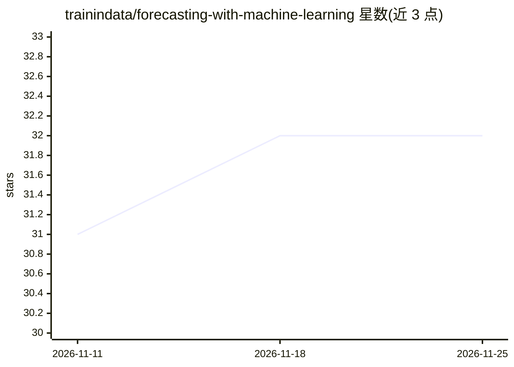

# trainindata/forecasting-with-machine-learning

⭐ 32 · Jupyter Notebook · NOASSERTION · 推送 2026-11-17 · [GitHub](https://github.com/trainindata/forecasting-with-machine-learning) · [官网](https://www.trainindata.com/p/forecasting-with-machine-learning) · 组织维护

**机器学习时间序列预测课程的实践笔记本代码仓库**

Train in Data 在线课程 Forecasting with Machine Learning 的配套代码仓库，以 Jupyter 笔记本形式覆盖：时间序列表格化（滞后/窗口/日期时间特征）、单步与多步预测（递归/直接策略）、多序列全局模型、回测（是否重拟合、扩展/滚动窗口、间歇重拟合、带间隔）与误差指标选择。示例基于 pandas 3、scikit-learn、Feature-engine 与 skforecast，需 Python 3.12+，通过 git clone 后 pip 安装依赖运行。

## 筛选速览

| 维度 | 判定 | 备注 |
|---|---|---|
| AI 角色 | `ai-knowledge` | 知识聚合/清单类 |
| 许可风险 | `permissive` | NOASSERTION |
| 部署形态 | `library` | 以包/库形式分发 |
| 模型依赖 | — | README 未给出锁定关系 |
| 硬件要求 | — | 无带数字的原话,不猜 |
| 安装摩擦 | `low` | 无编译、无系统依赖或容器化 |
| 成熟度 | — | 结构信号不足 |

## 能力要点

- 5 大模块笔记本：预测即回归、多步预测、多序列预测、回测、误差指标
- 示例使用 pandas 3、scikit-learn、Feature-engine、skforecast
- 提供虚拟环境与 Jupyter kernel 的完整搭建步骤

## 适用场景

- 跟学如何把时间序列转为回归问题并用机器学习建模
- 学习递归/直接多步预测与全局多序列建模的实践代码
- 参考回测策略与误差指标选择的实现

## 场景标签

`教程课程` · 领域:学习与行业

## 证据(README 行号)

> L7: Learn how to forecast time series with machine learning models: from turning time series into tabular data, to singl
> L9: This repository contains the practical notebooks for the **Forecasting with Machine Learning** course. The examples 

## 星数曲线

2026-11-11 31 → 2026-11-25 32（+1）

---
*卡片 v1 · prompt 1.4 · 生成 2026-11-18 · 置信度 high · 依据 README sha `8acccd3a7576` · [字段定义](../../DATASET.md)*
