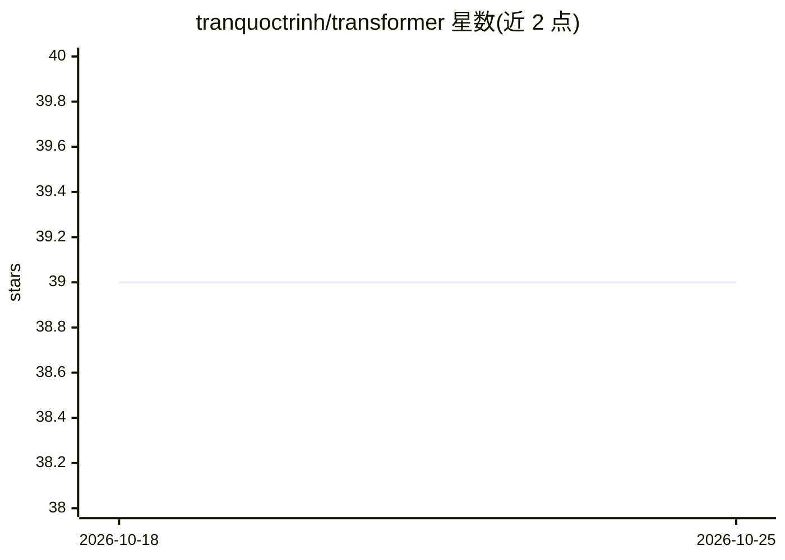

# tranquoctrinh/transformer

⭐ 39 · Python · MIT · 推送 2026-04-04 · [GitHub](https://github.com/tranquoctrinh/transformer) · 个人维护

**PyTorch 复现 Transformer 论文，训练英越机器翻译模型**

基于 Attention is All You Need 论文的 Transformer PyTorch 实现，模块包括位置编码、缩放点积注意力、多头注意力、编码器与解码器堆叠。支持在英语-越南语机器翻译数据集上训练，提供 train.py 训练、evaluate.py 评估（NLTK 计算 BLEU）、translate.py 推理脚本，并可下载预训练模型直接翻译。训练超参与数据下载流程在 README 中给出，参数集中在 utils.py 中可修改。

## 筛选速览

| 维度 | 判定 | 备注 |
|---|---|---|
| AI 角色 | `ai-native` | 本体是模型或模型工具 |
| 许可风险 | `permissive` | MIT |
| 部署形态 | `None` |  |
| 模型依赖 | — | README 未给出锁定关系 |
| 硬件要求 | — | 无带数字的原话,不猜 |
| 安装摩擦 | `low` | 无编译、无系统依赖或容器化 |
| 成熟度 | — | 结构信号不足 |

## 能力要点

- 按论文模块拆解的 Transformer PyTorch 实现（位置编码/多头注意力/编解码器）
- 提供英越翻译数据集下载与训练脚本，含早停机制
- 提供预训练模型下载与 translate.py 推理
- 使用 NLTK 计算 BLEU-2/3/4 评估指标

## 适用场景

- 学习 Transformer 论文结构的逐模块代码实现
- 训练并评估英越机器翻译模型
- 用预训练模型直接做英越翻译推理

## 场景标签

`模型训练` `教程课程` · 领域:学习与行业

## 证据(README 行号)

> L5: This is a PyTorch implementation of the Transformer model in the paper Attention is All You Need (Ashish Vaswani, No
> L11: The project support training and translation with trained model now.

## 星数曲线

2026-10-18 39 → 2026-10-25 39（+0）

---
*卡片 v1 · prompt 1.4 · 生成 2026-10-25 · 置信度 high · 依据 README sha `2415934b36f0` · [字段定义](../../DATASET.md)*
