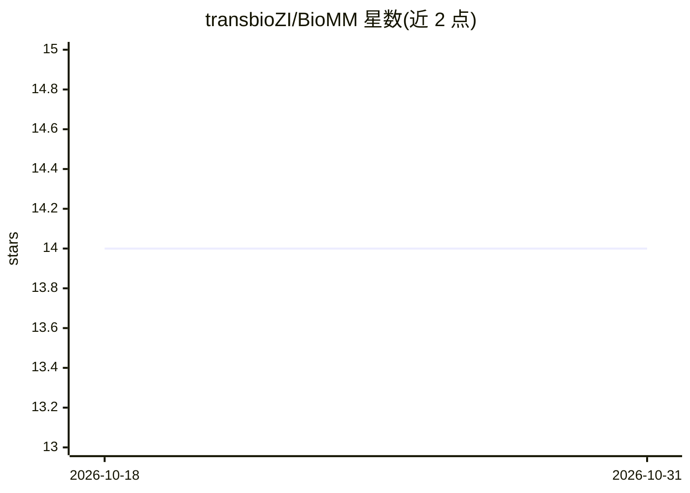

# transbioZI/BioMM

⭐ 14 · HTML · 推送 2026-06-14 · [GitHub](https://github.com/transbioZI/BioMM) · 组织维护

**面向组学表型预测的生物信息引导两阶段机器学习框架（R 包）**

BioMM 是一个 R 语言实现的生物信息引导多阶段机器学习框架，用于基于高维组学数据（如 DNA 甲基化、基因组学）的表型/疾病结局预测。机制上分两阶段：第一阶段借助 GO/KEGG 等通路注释将特征（CpG、基因、SNP）映射到生物学分层结构，结合重采样策略（交叉验证或自助法）构造 stage-2 特征；第二阶段用监督模型（如随机森林）基于非负结局相关特征做最终预测。提供特征映射、方差解释可视化、通路排序（negPlogit/R2/Zscore）与 circos 图等功能，附带 40 例 26486 CpG 的示例甲基化数据。限制：两阶段均用监督模型时运行时间较长，生物学参数需人工预先设定。

## 筛选速览

| 维度 | 判定 | 备注 |
|---|---|---|
| AI 角色 | `ai-native` | 本体是模型或模型工具 |
| 许可风险 | `none` | — |
| 部署形态 | `None` |  |
| 模型依赖 | — | README 未给出锁定关系 |
| 硬件要求 | — | 无带数字的原话,不猜 |
| 安装摩擦 | `low` | 无编译、无系统依赖或容器化 |
| 成熟度 | — | 结构信号不足 |

## 能力要点

- 支持多种组学数据模态（甲基化组、基因组等）
- 基于 GO/KEGG/Reactome 通路注释的生物分层策略
- 两阶段学习框架结合交叉验证/自助重采样构造 stage-2 特征
- 提供方差解释、通路优先排序与 circos 可视化功能

## 适用场景

- 用 DNA 甲基化或基因表达数据预测疾病结局
- 识别与结局相关的可解释生物学通路模式
- 为复杂疾病构建基于生物分层的个体化风险评分

## 场景标签

 · 领域:生物信息学/基因组学

## 证据(README 行号)

> L9: We have implemented a biologically informed multi-stage machine learning framework termed __BioMM__ [1] specifically
> L66: The BioMM model framework mainly consists of two learning stages [1]. During the first stage, the stage-1 model (ei

## 星数曲线

2026-10-18 14 → 2026-10-31 14（+0）

---
*卡片 v1 · prompt 1.4 · 生成 2026-10-31 · 置信度 high · 依据 README sha `0ad71c937901` · [字段定义](../../DATASET.md)*
