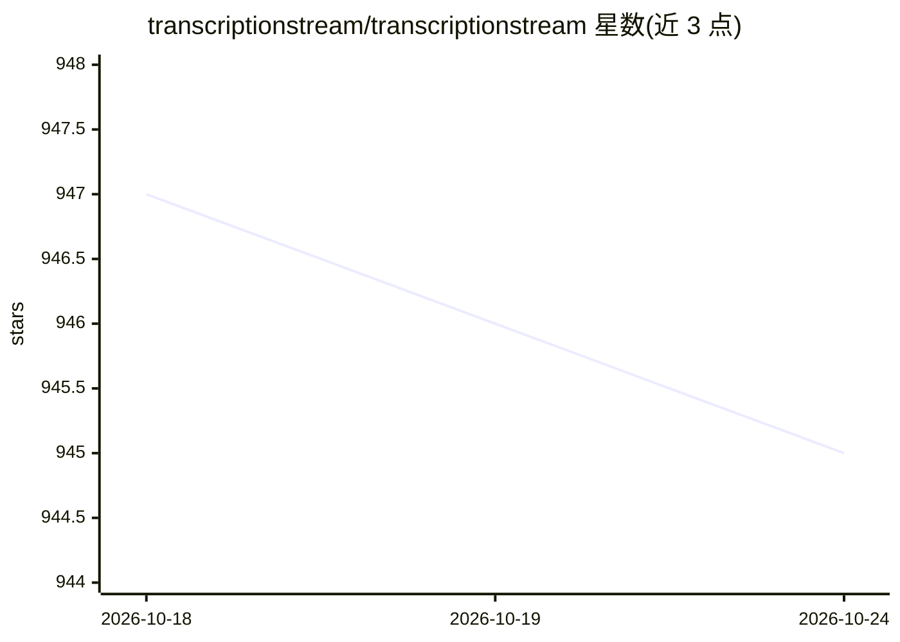

# transcriptionstream/transcriptionstream

⭐ 945 · Python · GPL-3.0 · 推送 2026-01-18 · [GitHub](https://github.com/transcriptionstream/transcriptionstream) · 组织维护

**自托管离线转写与说话人分离服务，含 LLM 摘要**

基于 Docker 的开箱即用自托管转写服务：通过 SSH 拖放区（transcribe/diarize 目录）或 Web 界面上传音频，使用 whisper-diarization/whisperx 处理，输出带说话人分离的转写文本；内置 Ollama + Mistral 生成摘要，Meilisearch 提供全文搜索，Web 界面支持带时间同步高亮的播放器。前置要求为 NVIDIA GPU，ts-gpu 镜像约 26GB；README 声明为示例代码，生产环境需自行加固。

## 筛选速览

| 维度 | 判定 | 备注 |
|---|---|---|
| AI 角色 | `ai-native` | 本体是模型或模型工具 |
| 许可风险 | `viral` | GPL-3.0 |
| 部署形态 | `self-host` | docker 或自建部署 |
| 模型依赖 | local-ok | 支持本地模型 |
| 硬件要求 | — | 无带数字的原话,不猜 |
| 安装摩擦 | `low` | 无编译、无系统依赖或容器化 |
| 成熟度 | — | 结构信号不足 |

## 能力要点

- SSH 拖放与 Web 界面两种上传方式，输出至命名日期文件夹
- Ollama + Mistral 摘要，提示词可自定义
- Web 播放器支持时间同步的转写高亮与滚动
- Meilisearch 全文搜索与多端口服务暴露

## 适用场景

- 在本地离线批量转写会议或访谈录音并区分说话人
- 为转写结果自动生成包含说话人信息的摘要
- 在自托管环境中搭建私有转写服务避免数据外传

## 场景标签

`语音识别` · 领域:感知与多模态

## 证据(README 行号)

> L5: Transcription Stream is a turnkey self-hosted diarization service that works completely offline. Out of the box it i
> L6: - drag and drop diarization and transcription via SSH
> L8: - summarization with Ollama and Mistral

## 星数曲线

2026-10-18 947 → 2026-10-24 945（-2）

---
*卡片 v1 · prompt 1.4 · 生成 2026-10-21 · 置信度 high · 依据 README sha `aeb859c272b1` · [字段定义](../../DATASET.md)*
