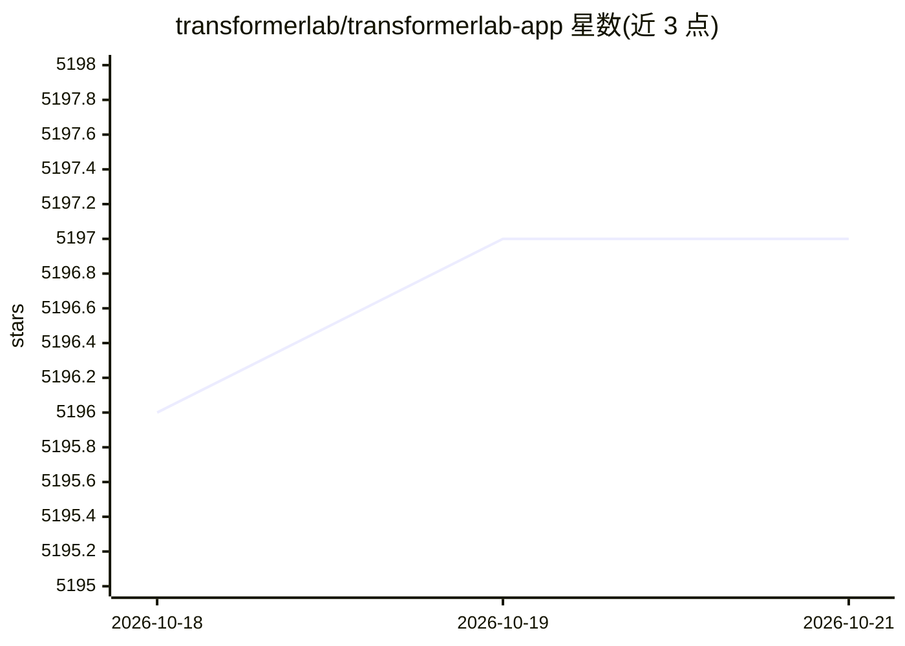

# transformerlab/transformerlab-app

⭐ 5,197 · Python · AGPL-3.0 · 推送 2026-10-19 · [GitHub](https://github.com/transformerlab/transformerlab-app) · [官网](https://lab.cloud) · 组织维护

**面向 AI 研究者的开源训练/评测/推理一体化平台**

Transformer Lab 是开源机器学习平台，分个人版与团队版：个人版在单机本地训练、微调、对话与评测模型，支持 macOS Apple Silicon、Linux 与 Windows WSL2；团队版作为 Slurm/SkyPilot 集群的控制平面提交任务，提供实验追踪与模型注册。训练方法覆盖全量微调、LoRA/QLoRA、RLHF 等；推理引擎支持 MLX、vLLM、Ollama 与 Transformers；另含扩散模型生成与训练、LLM-as-a-Judge 评测、LM Evaluation Harness 基准、插件体系与 Lab SDK。AGPL-3.0 许可。

## 筛选速览

| 维度 | 判定 | 备注 |
|---|---|---|
| AI 角色 | `ai-ecosystem` | LLM/agent 周边工具 |
| 许可风险 | `viral` | AGPL-3.0 |
| 部署形态 | `library` | 以包/库形式分发 |
| 模型依赖 | local-ok | 支持本地模型 |
| 硬件要求 | — | 无带数字的原话,不猜 |
| 安装摩擦 | `medium` | 含编译或系统依赖之一 |
| 成熟度 | — | 结构信号不足 |

## 能力要点

- 全量微调/LoRA/QLoRA/RLHF（DPO、ORPO、SIMPO）训练与超参数网格搜索
- 推理引擎支持 MLX、vLLM、Ollama、Transformers，格式转换 HF/GGUF/MLX
- 内置 EleutherAI LM Evaluation Harness 基准与 LLM-as-a-Judge 评测
- Slurm/SkyPilot 集群任务提交与 Python 插件架构、Lab SDK

## 适用场景

- 在本地 Apple Silicon 或 GPU 机器上微调与评测开源 LLM
- 研究团队从统一 UI 向 Slurm 集群或云提交训练任务
- 训练 Stable Diffusion LoRA 并进行基准评测与红队测试

## 场景标签

`模型评测` `微调` `推理引擎` `强化学习` · 领域:评测与运维

## 证据(README 行号)

> L32: Transformer Lab is an open-source machine learning platform that unifies the fragmented AI tooling landscape into a
> L61: - **Unified Interface:** Train on local hardware or submit tasks to remote clusters using the same UI.
> L118: Transformer Lab for Teams runs as an overlay on your existing infrastructure. It does not replace your scheduler; 

## 星数曲线

2026-10-18 5,196 → 2026-10-21 5,197（+1）

---
*卡片 v1 · prompt 1.4 · 生成 2026-10-20 · 置信度 mid · 依据 README sha `c67ae32a0ee2` · [字段定义](../../DATASET.md)*
