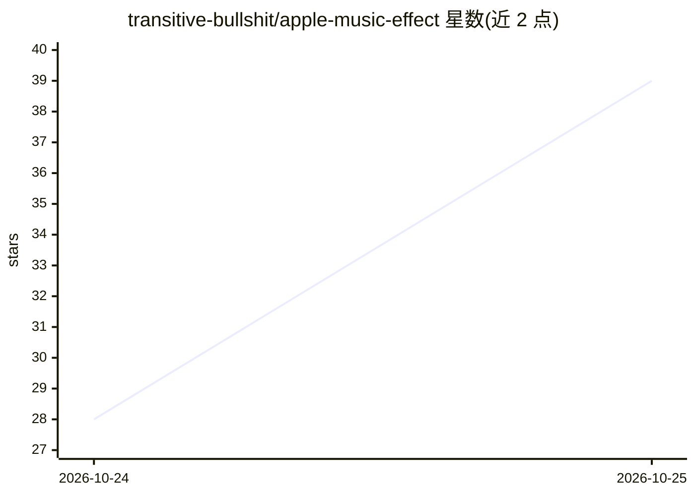

# transitive-bullshit/apple-music-effect

⭐ 42 · TypeScript · MIT · 推送 2026-10-23 · [GitHub](https://github.com/transitive-bullshit/apple-music-effect) · [官网](https://apple-music-effect.transitivebullsh.it) · 个人维护

**浏览器中重建 Apple Music 液态 logo 动画的 WebGL 项目**

用 WebGL 在浏览器中重建 Apple Music 新品牌标识的液态镜头动画：以物理方式模拟油膜透镜放大并拖影任意 logo，配合光谱光线追踪生成彩虹边缘；动画曲线拟合自 Apple 官方影片。提供在线播放器（可导入自定义图标/字标、调节油与光照参数、导出 1080p/4K MP4）、原理讲解文档，以及确定性无头渲染与对照官方影片的比较工具。运行需 Node 24+、pnpm、uv、ffmpeg 与 Chrome。非官方研究，不隶属 Apple。

## 筛选速览

| 维度 | 判定 | 备注 |
|---|---|---|
| AI 角色 | `ai-enhanced` | 去掉 AI 部分产品仍成立 |
| 许可风险 | `permissive` | MIT |
| 部署形态 | `None` |  |
| 模型依赖 | — | README 未给出锁定关系 |
| 硬件要求 | — | 无带数字的原话,不猜 |
| 安装摩擦 | `medium` | 含编译或系统依赖之一 |
| 成熟度 | — | 结构信号不足 |

## 能力要点

- GPU 上的油膜透镜物理模拟与光谱光线追踪
- 可导入自定义图标与字标并从浏览器导出 1080p/4K MP4
- 确定性无头渲染与对照 Apple 影片的比较工具（逐帧与曲线校验）
- 随附效果原理讲解

## 适用场景

- 在浏览器中复刻 Apple Music 液态 logo 动效并替换为自己的品牌素材
- 导出带该效果的品牌动画视频
- 学习光谱光线追踪与效果比对校验的实现方法

## 场景标签

 · 领域:图形/创意编程

## 证据(README 行号)

> L3: > A real-time recreation of the liquid logo animation from Apple Music's new identity: a physically based lens of oi
> L9: Apple filmed its new mark in a tray of mineral oil, rippled by a two-note sting from Fred again.. and NEST Acoustics
> L25: Paste this into a coding agent:

## 星数曲线

2026-10-24 28 → 2026-10-25 39（+11）

---
*卡片 v1 · prompt 1.4 · 生成 2026-10-25 · 置信度 mid · 依据 README sha `42b56756b914` · [字段定义](../../DATASET.md)*
