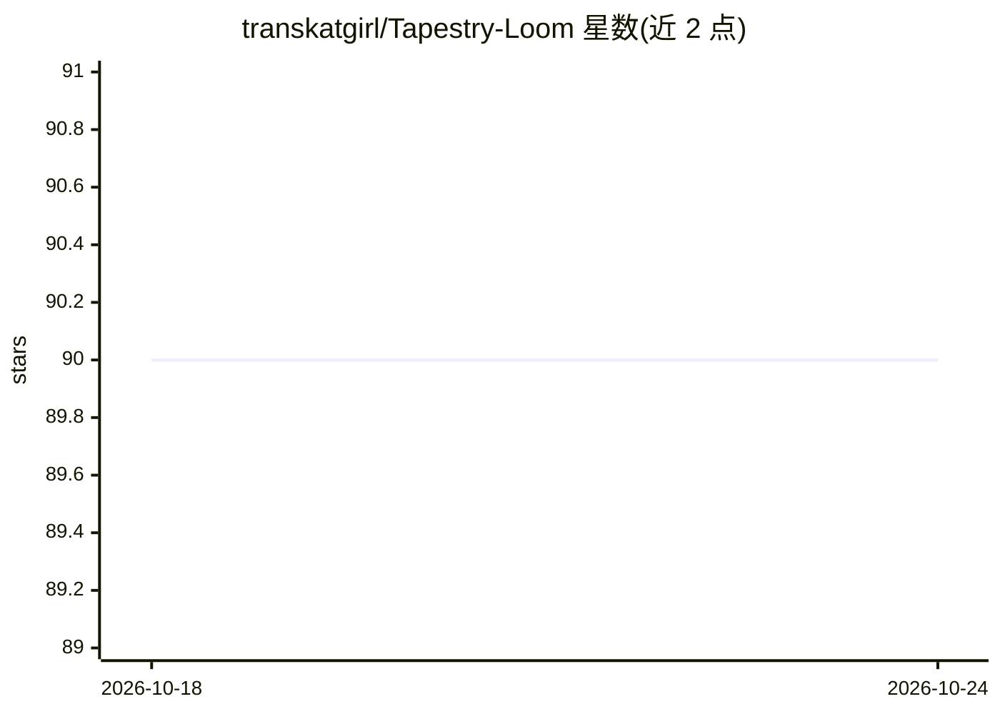

# transkatgirl/Tapestry-Loom

⭐ 90 · Rust · AGPL-3.0 · 推送 2026-10-09 · [GitHub](https://github.com/transkatgirl/Tapestry-Loom) · 个人维护

**面向高级用户的 LLM 基础模型 Loom 界面：树状分支生成与 token 概率分析**

基于 egui 的桌面应用，为 LLM 基础模型提供 Loom 式操作界面：以树状『weave』结构逐 token/逐节点生成分支文本，展示 token 边界、logprob 高亮等概率信息，支持从 loom 等其他 Loom 实现迁移数据。推理依赖外部后端：推荐 llama.cpp 的 llama-server（功能适配最全），vLLM 需附加请求参数；README 明确不建议使用 Ollama、KoboldCpp 与 LM Studio，并列出 OpenRouter 等推理服务商的已知兼容问题。提供预编译二进制，也可用 Rust 从源码编译。应用自述为开发中状态（work in progress）。

## 筛选速览

| 维度 | 判定 | 备注 |
|---|---|---|
| AI 角色 | `ai-native` | 本体是模型或模型工具 |
| 许可风险 | `viral` | AGPL-3.0 |
| 部署形态 | `desktop` | 安装包/桌面程序 |
| 模型依赖 | local-ok | 支持本地模型 |
| 硬件要求 | — | 无带数字的原话,不猜 |
| 安装摩擦 | `medium` | 含编译或系统依赖之一 |
| 成熟度 | `idea` | |

## 能力要点

- 树状 weave 结构的多分支生成与 token/logprob 展示
- 推荐 llama-server 并给出完整启动参数；vLLM 需附加 return_token_ids 等参数
- 提供从 loom 等其他 Loom 实现迁移 weaves 的迁移助手
- 可选 tokenization server，可复用输出 token ID 改善非 ASCII 场景质量

## 适用场景

- 在本地 llama-server 上对基础模型做逐 token 分支探索
- 分析候选 token 的概率分布与采样行为
- 把其他 Loom 工具的既有 weaves 迁移过来继续编辑

## 场景标签

`AI 写作` · 领域:内容生成

## 证据(README 行号)

> L3: A power user focused interface for LLM base models, inspired by the designs of loom, loomsidian, exoloom, logitloom,
> L26: > This application is a work in progress; Please make backups and report any bugs that you find.

## 星数曲线

2026-10-18 90 → 2026-10-24 90（+0）

---
*卡片 v1 · prompt 1.4 · 生成 2026-10-23 · 置信度 high · 依据 README sha `e61ce839b216` · [字段定义](../../DATASET.md)*
