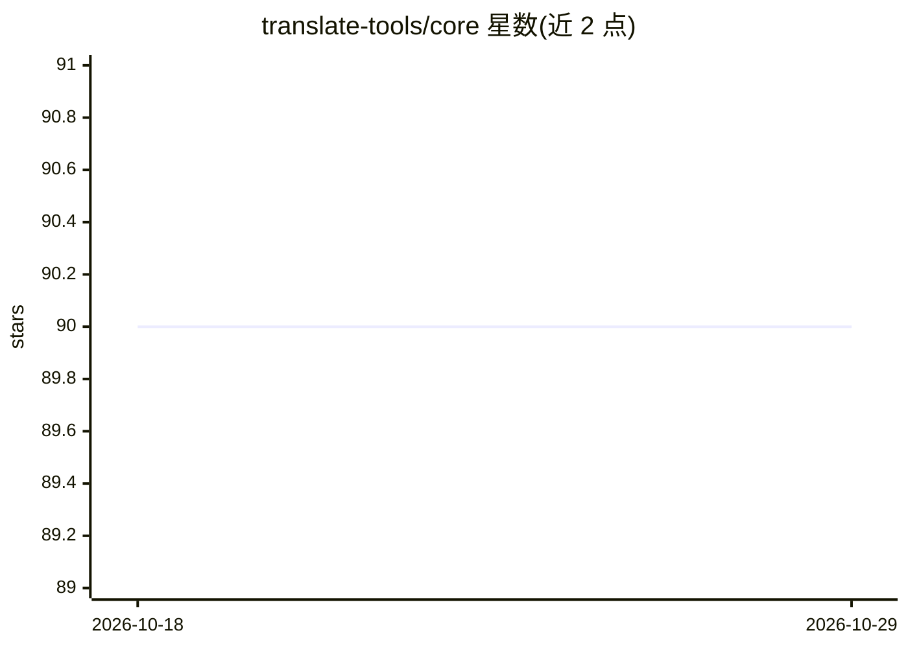

# translate-tools/core

⭐ 90 · TypeScript · Apache-2.0 · 推送 2026-08-06 · [GitHub](https://github.com/translate-tools/core) · [官网](https://npmjs.com/anylang) · 组织维护

**JavaScript 翻译工具库：聚合 Google/Bing/LLM 等多种翻译 API**

AnyLang 是用于构建自有翻译系统的 npm 包（anylang），提供翻译器绑定（Google、Yandex、Duck.ai、ChatGPT、Gemini、DeepL、LibreTranslate 等，分免费/不稳定/需 API key 三类）、将多次调用合并为单请求的调度器（含缓存装饰器）、文本转语音模块（GoogleTTS、LingvaTTS）、语言代码工具与回退/伪造翻译器等原语，接口统一，可自定义 fetcher 与 LLM 翻译器组合。同时提供 CJS 与 ESM 模块。NodeJS 下需设置 User-Agent。

## 筛选速览

| 维度 | 判定 | 备注 |
|---|---|---|
| AI 角色 | `ai-native` | 本体是模型或模型工具 |
| 许可风险 | `permissive` | Apache-2.0 |
| 部署形态 | `library` | 以包/库形式分发 |
| 模型依赖 | — | README 未给出锁定关系 |
| 硬件要求 | — | 无带数字的原话,不猜 |
| 安装摩擦 | `low` | 无编译、无系统依赖或容器化 |
| 成熟度 | — | 结构信号不足 |

## 能力要点

- 聚合免费/不稳定/需密钥三类翻译 API 的统一接口
- ChatGPTLLMTranslator、GeminiLLMTranslator 等预设 LLM 翻译器，可用原语自建
- 调度器将高频翻译请求批量为单次 API 请求，带缓存装饰器
- 回退翻译器按失败自动切换下一个服务，可聚合不同语言方向的翻译器

## 适用场景

- 在我的应用里接入多来源机器翻译并做失败回退
- 高频调用翻译 API 时用调度器避免限流
- 构建带 TTS 与语言代码管理的 i18n 翻译流程

## 场景标签

`语音合成` · 领域:内容生成

## 证据(README 行号)

> L3: The **AnyLang** kit is purposed to build your own translation system.
> L6: - **Translators**. Bindings to a popular translation APIs, LLMs, and free translation services like Google Translate
> L107: - `ChatGPTLLMTranslator`

## 星数曲线

2026-10-18 90 → 2026-10-29 90（+0）

---
*卡片 v1 · prompt 1.4 · 生成 2026-10-23 · 置信度 high · 依据 README sha `abbe4ddd4cbf` · [字段定义](../../DATASET.md)*
