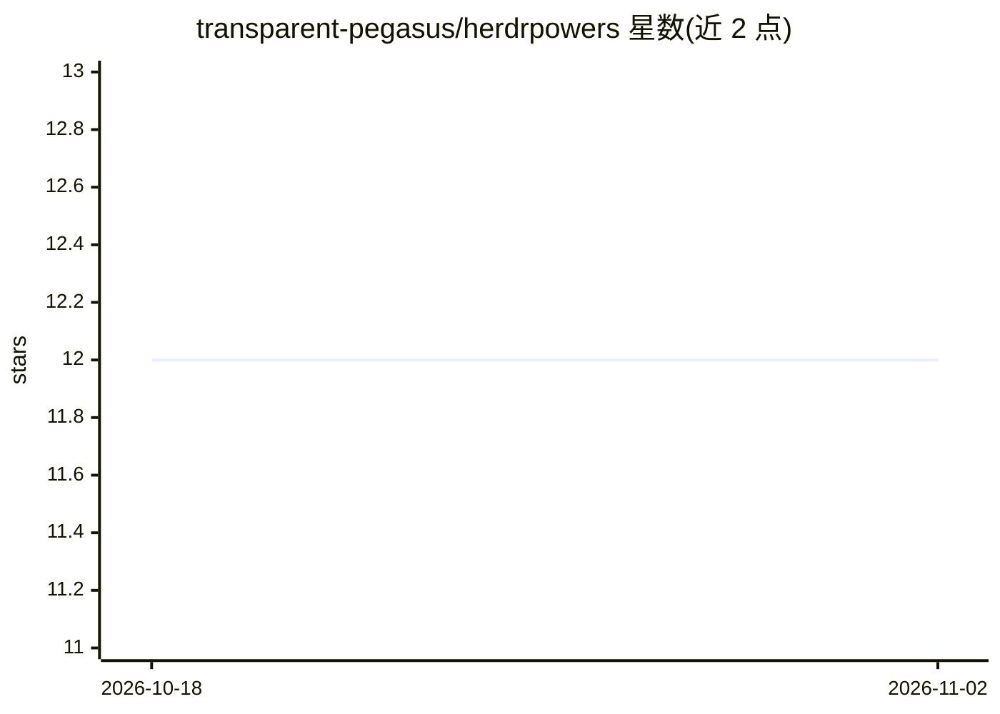

# transparent-pegasus/herdrpowers

⭐ 12 · Shell · MIT · 推送 2026-10-28 · [GitHub](https://github.com/transparent-pegasus/herdrpowers) · 个人维护

**在 herdr 面板中运行 AI 编码代理的开发框架与技能包**

面向运行于 herdr 终端复用器内 AI 编码代理的开发框架：把源自 obra/superpowers 的开发方法论（头脑风暴、计划、TDD、调试、评审）重构为面板驱动派发——任务交给空闲的同级 agent 面板执行而非进程内子代理，通过 composer 提交脚本与文件传递结果，git worktree 隔离工作区，测试归属由 test-authoring 配置决定。含 16 个技能与 7 个命令工作流，支持 Claude Code、Codex、Cursor、OpenCode 插件安装，角色与派发默认值在目标仓库的 config.yaml 中配置。脱离 herdr 时降级为内联执行并在报告中注明。

## 筛选速览

| 维度 | 判定 | 备注 |
|---|---|---|
| AI 角色 | `ai-ecosystem` | LLM/agent 周边工具 |
| 许可风险 | `permissive` | MIT |
| 部署形态 | `None` |  |
| 模型依赖 | — | README 未给出锁定关系 |
| 硬件要求 | — | 无带数字的原话,不猜 |
| 安装摩擦 | `low` | 无编译、无系统依赖或容器化 |
| 成熟度 | — | 结构信号不足 |

## 能力要点

- 任务派发给空闲同级 agent 面板而非进程内子代理
- 16 个技能 + 7 个命令工作流（init/plan/execute/full_cycle 等）
- test-authoring 配置决定测试由独立面板或实现者撰写
- 支持 Claude Code/Codex/Cursor/OpenCode 插件市场安装

## 适用场景

- 在 herdr 中编排多个 agent CLI 面板并行完成开发任务
- 用结构化工作流（计划→实现→测试→五重评审）驱动编码代理
- 让不同厂商的 agent CLI 在同一开发周期中分工协作

## 场景标签

`编码 Agent` `多智能体` · 领域:Agent 开发

## 证据(README 行号)

> L3: **herdrpowers** is a development framework for AI coding agents running inside herdr. It layers structured skills an
> L142: Superpowers is skill-triggered and subagent-driven: skills fire on their own as the conversation goes, and `subage

## 星数曲线

2026-10-18 12 → 2026-11-02 12（+0）

---
*卡片 v1 · prompt 1.4 · 生成 2026-10-31 · 置信度 high · 依据 README sha `5736d1def9ec` · [字段定义](../../DATASET.md)*
