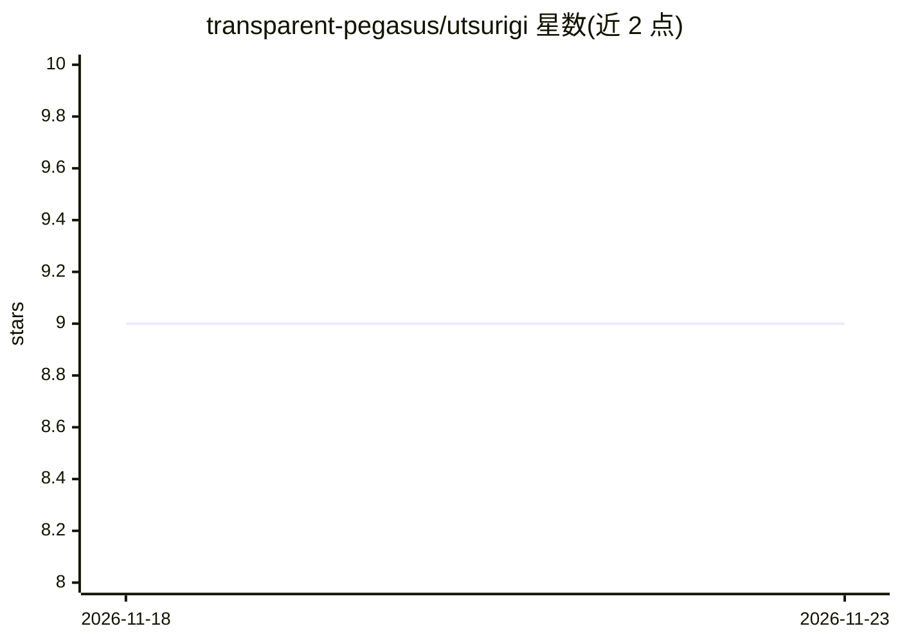

# transparent-pegasus/utsurigi

⭐ 9 · Rust · MIT · 推送 2026-11-17 · [GitHub](https://github.com/transparent-pegasus/utsurigi) · 个人维护

**为多服务 AI Bot 外置数据并统一管理的工具**

utsurigi 将 AI Bot 的数据外置到统一存储（默认经 Bot 连接器写入 Google Drive，也支持 R2 等存储），使同一 Bot 可跨服务使用、任务与知识可跨 Bot 共享。机制包括加密备份与恢复、命名 hub、分钟级 live sync、对话式设置、YAML 配置，以及强制性的任务管理；可选 Memory RAG/Caveman 功能。恢复验证要求 restic check、逐字节比对的恢复测试与远程取回验证。面向单一所有者下的可信 Bot；要求 Unix 与 Rust，仅在 Linux 上验证过。

## 筛选速览

| 维度 | 判定 | 备注 |
|---|---|---|
| AI 角色 | `ai-ecosystem` | LLM/agent 周边工具 |
| 许可风险 | `permissive` | MIT |
| 部署形态 | `None` |  |
| 模型依赖 | — | README 未给出锁定关系 |
| 硬件要求 | — | 无带数字的原话,不猜 |
| 安装摩擦 | `low` | 无编译、无系统依赖或容器化 |
| 成熟度 | — | 结构信号不足 |

## 能力要点

- 加密外置存储与恢复，支持 Google Drive/R2 等后端
- 任务与规则分钟级同步到 Bot 的其他运行时与对端（跨机仅 R2）
- 对话式设置，配置用 YAML；共享任务为强制项
- 设置通过 restic check 与逐字节恢复比对后才算通过

## 适用场景

- 把同一 Bot 的数据带到其他服务上继续使用
- 多个 Bot 之间共享任务、依赖、目标与日志等状态
- 为 Bot 数据建立加密备份并验证可恢复性

## 场景标签

`Agent 记忆` `知识库管理` · 领域:Agent 开发

## 证据(README 行号)

> L3: Keep Bot data in one external store. Then:
> L5: - Send tasks to Bots on other services. Share knowledge with them.
> L68: For trusted Bots under one owner. Requires Unix and Rust.

## 星数曲线

2026-11-18 9 → 2026-11-23 9（+0）

---
*卡片 v1 · prompt 1.4 · 生成 2026-11-20 · 置信度 mid · 依据 README sha `273671145f76` · [字段定义](../../DATASET.md)*
