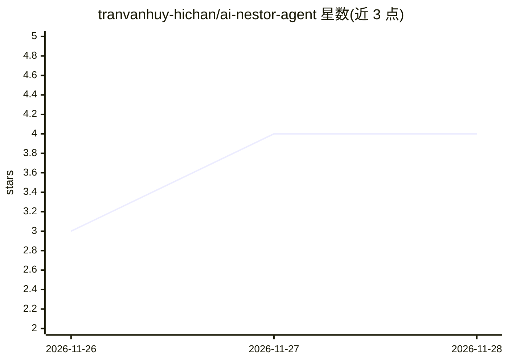

# tranvanhuy-hichan/ai-nestor-agent

⭐ 4 · Python · AGPL-3.0 · 推送 2026-11-24 · [GitHub](https://github.com/tranvanhuy-hichan/ai-nestor-agent) · 个人维护 · 中文 README

**本地优先的个人 AI 助手：终端/网页对话、文档问答与后台自动化**

运行在本机的开源个人 AI 助手：支持终端 CLI（流式输出、斜杠命令）、Web UI（带工作区面板）及 Telegram/Zalo OA 消息通道，通过后台网关调度任务。能力覆盖多模型接入与降级配置、PDF/Word/表格/幻灯片等文档索引与引用溯源（Tesseract 可用时支持扫描件 OCR）、Markdown 记忆与历史会话检索、SKILL.md 技能安装与 MCP 工具接入、定时任务与 Kanban 后台作业。数据默认存于本地 user-data 目录，网关默认绑定 localhost。要求 Python 3.11+，Web 界面需 Node.js 20+ 构建。

## 筛选速览

| 维度 | 判定 | 备注 |
|---|---|---|
| AI 角色 | `ai-native` | 本体是模型或模型工具 |
| 许可风险 | `viral` | AGPL-3.0 |
| 部署形态 | `self-host` | docker 或自建部署 |
| 模型依赖 | local-ok | 支持本地模型 |
| 硬件要求 | — | 无带数字的原话,不猜 |
| 安装摩擦 | `low` | 无编译、无系统依赖或容器化 |
| 成熟度 | — | 结构信号不足 |

## 能力要点

- 多模型接入：Ollama/本地 OpenAI 兼容端点或 Gemini/Claude/OpenAI/OpenRouter 云端，可配置 fallback
- 文档 RAG：索引多格式文件并支持引用回溯到原文段落，可选 Tesseract OCR
- SKILL.md 技能安装、MCP 服务器工具接入，并通过 /v1/run API 供其他应用调用
- 后台自动化：Kanban 卡片派发、定时任务与 Heartbeat 巡检

## 适用场景

- 在终端或浏览器里用本地模型聊天并处理任务
- 对自己的 PDF、Word、表格文档提问并查看引用出处
- 用 Telegram/Zalo 远程给助手派活并监控后台任务
- 整理越南语行政文书与生成办公文档

## 场景标签

`AI 助手` `文档问答` · 领域:对话与助手

## 证据(README 行号)

> L11: Nestor Agent is an open-source personal AI assistant that runs on your machine. Chat in the terminal or browser, as
> L17: |**Your choice of models**|Run Ollama or another OpenAI-compatible local endpoint, or configure cloud providers suc
> L22: |**Memory, skills, and tools**|Reuse Markdown memory and search past conversations. Install `SKILL.md` skills or co

## 星数曲线

2026-11-26 3 → 2026-11-28 4（+1）

---
*卡片 v1 · prompt 1.4 · 生成 2026-11-26 · 置信度 high · 依据 README sha `21db9c6e7774` · [字段定义](../../DATASET.md)*
